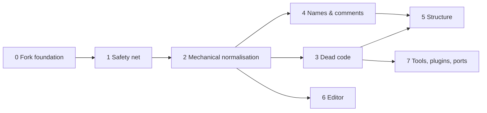

# AGS Draconian refactor plan

A staged plan for turning a codebase that grew from a 1990s DOS program into one that is
consistent, testable and easy to navigate, **without breaking the games built on it**.

- **Style rules:** [STYLE.md](STYLE.md)
- **Starting numbers:** [BASELINE.md](BASELINE.md), recomputed with `python Script/refactor_metrics.py`
- **Status:** tick the boxes in this file as tasks land, and reference the task ID (`3.2`) in commit
  messages and PRs.

## How to use this plan

The work is split into phases. Each phase has numbered tasks, and every task has a **done when**
line you can check. Phases 0–2 must be done in order and before anything else: they build the
safety net and the tooling. After that, phases 3–7 can overlap and be done **module by module**.
For example, `Engine/ac/overlay.cpp` can go through phase 4 while the Editor is still in phase 6.

Rough sizing, for one developer part-time: phases 0–2 take weeks, phases 3–4 take a few months,
and phases 5–6 are ongoing over a year or more. Each phase is useful on its own, so stopping
after any of them still leaves the code better than before.

## Ground rules

1. **It's a hard fork.** Upstream `adventuregamestudio/ags` is no longer merged wholesale. Fixes
   are cherry-picked by hand and recorded in `docs/UPSTREAM.md` (task 0.2). Being free of merges is
   what makes the reformat, renames and moves in this plan affordable, so make full use of it.
2. **The compatibility contract is sacred** (see below). Anything not on it may change freely.
3. **Safety net before surgery.** No structural change to a subsystem until phase 1 has given it
   tests that would catch a regression.
4. **One kind of change per commit** (STYLE.md, "Commits"): format, rename, move, delete, or
   behaviour. Mechanical commits are verified by object-code comparison (task 1.6).
5. **Ratchets, not big bangs.** CI enforces style on changed lines from day one. Metrics in
   BASELINE.md may only go down. A PR that makes a metric worse needs a stated reason.
6. **Boy-scout rule, with limits.** When you touch a function for a fix, you may rename its locals
   and fix its comments in a *separate* preceding commit. Don't refactor the surroundings in the
   same PR as the fix.

## Compatibility contract

These interfaces are frozen unless a task explicitly versions them. Each one gets a guard test in
phase 1.

| # | Interface | Where it lives | Why it's frozen |
|---|---|---|---|
| C1 | Game data: `.ags`, `.crm`, sprite file + index, `.tra`, `.wfn`, **from 3.99 onward** (D1) | `Common/game/*`, `Common/ac/spritefile.*`, `Common/data/*` | Games built with 3.99/4.x editors must keep loading |
| C2 | Savegame format, for saves written by 3.99+ engines | `Engine/game/savegame*.cpp` | Players' saves of those games |
| C3 | Script ABI: exported API names and signatures, `game.*`/`system.*` field offsets, bytecode | `Register*API()`, `Engine/ac/dynobj/scriptgame.cpp` and friends, `Engine/script/scriptexecutor.cpp`, `Editor/AGS.Editor/Resources/agsdefns.sh` | Compiled game scripts link by name and offset |
| C4 | Plugin API: `IAGSEngine` vtable order, `AGS_Engine*` exports | `Engine/plugin/agsplugin.h` | Binary plugins built against the SDK |
| C5 | Editor project format (`Game.agf`, `.user`, room `.crm` source) and editor plugin API | `Editor/AGS.Types` | Existing projects and editor plugins |
| C6 | Engine command line and `acsetup.cfg` keys | `Engine/main/main.cpp`, `Engine/main/config.cpp` | Launchers, store builds, players' configs |

Note that C3 is defined by offsets and names, **not** by C++ struct layout. For example,
`GamePlayState` fields are read through the offset switch in `CCScriptGame::ReadInt32`, so
renaming or reordering the C++ fields is safe as long as that table stays correct.

## Purpose of the fork

This fork is a testbed for **AI-assisted refactoring**. That affects how the tasks are written:
each one should fit in a single session, have a "done when" line a machine can check, and be
backed by an automatic verifier (tests, the contract snapshots from 1.2, the object-code comparison
from 1.6, the metrics script). When a session starts a task, it should read this file, STYLE.md and
the task's section, and finish by updating the checkbox and the progress table.

## Decisions

Recorded 2026-10-31.

| ID | Question | Decision | Consequences | Unblocks |
|---|---|---|---|---|
| D1 | Oldest game version the fork must load (C1) | **3.99 and later** (`kGameVersion_399`) | All 3.x upgrade paths can go (task 3.4). Room versions need care, see 3.4. | 3.4 |
| D2 | Which platforms to ship on | **Windows, Linux, macOS, Android, Web, iOS.** Drop PSP. FreeBSD stays for now (small, shares the POSIX code). | iOS can't be tested locally (no Mac), so it gets a compile-only CI job (7.3) | 3.1, 7.3 |
| D3 | Keep the legacy script compiler? | **Remove `Compiler/script`** | `script2` becomes the only compiler (3.3) | 3.3 |
| D4 | Future of the Editor UI | **Avalonia is the main candidate.** The WinForms editor goes into maintenance mode. | Editor work concentrates on a UI-free core shared by both UIs, and on replacing the C++/CLI bridge, which Avalonia can't use (phase 6) | 6.x |
| D5 | Single build system for native code | **CMake only.** MSBuild stays for the C# editor projects. | Hand-written Makefiles and the native `Solutions/*.vcxproj` go (3.2) | 3.2 |
| D6 | Minimum Windows version | **Windows 7+** | Drop `v141_xp`; `AGS.Native` targets `0x0601` instead of XP's `0x0501`; no APIs newer than Windows 7 without a runtime check | 0.4, 3.1 |
| D7 | How are games built, by the editor and headless? | **One C# build core (`AGS.Editor.Core`) used by both the GUI editor and a new C# command-line builder. Retire the C++ project pipeline in `Tools/`** (everything that reads `Game.agf`). Keep the thin C++ format tools. | The C++ pipeline is a second copy of the project model that always lags: since 2025, `AGS.Types` had 302 commits vs 23 for `agfreader.cpp`, and `DataFileWriter.cs` 81 vs 16 for `data_file_writer.cpp`. With the build in C#, `Game.agf` has exactly one reader. Formats the engine reads through `Common/` (rooms, sprites, translations, compiled scripts) are still written by the C++ code, through the C library from 6.7c. The command-line builder needs the .NET 8 runtime or a self-contained build (~70 MB); NativeAOT isn't realistic because `AGS.Types` uses reflection-based XML serialization. | 6.0, 6.7d, 7.1 |

---

## Phase 0: Fork foundation

- [x] **0.1 Tag the fork point.** Tag `fork-point` at `4cd88beba` (the current merge base with
  `upstream/ags4`). Keep the `upstream` remote for reference only.
  *Done when:* the tag exists and the README states the project is a hard fork.
- [x] **0.2 Cherry-pick ledger.** Create `docs/UPSTREAM.md`: a table of upstream commits that were
  picked, adapted or deliberately skipped. Every cherry-pick gets a line.
  *Done when:* the file exists and the cherry-pick process is described in CONTRIBUTING.md.
- [x] **0.3 Record decisions D1–D6** in the table above.
- [x] **0.4 Raise the toolchain floor.** `CXX_STANDARD 17` in all `CMakeLists.txt` (currently 11 in
  `Engine/` and `Common/`), `LanguageStandard stdcpp17` in all `.vcxproj`, `cmake_minimum_required`
  3.16+. For D6 (Windows 7+): replace the `v141_xp` toolset in `Solutions/Common.Lib` and the other
  projects with `v143`, and raise `WINVER`/`_WIN32_WINNT` in `Editor/AGS.Native/stdafx.h` from
  `0x0501` (XP) to `0x0601` (Windows 7). The Vista check in `Engine/platform/windows/acplwin.cpp`
  becomes always true and can go.
  *Done when:* CI is green on every platform with C++17, and no XP toolset or define remains.
  *Status (2026-11-01):* implemented, not yet committed. Verified on Windows only: `Engine.sln`,
  `Tests.sln` and `AGS.Editor.Full.sln` (Release x86, MSBuild) and the CMake build (x64, tools + tests)
  build with 0 errors; unit tests pass (MSBuild: Common 96, Engine 3, Tools 76; CMake ctest: 739/739);
  `ags.exe` still links the static runtime. CI (run 41287882653 and the re-run of its failed jobs):
  green on Windows, MinGW x64/arm64, Ubuntu x64/arm64, macOS, and the Linux packaging jobs (Debian
  Buster image, glibc 2.28). Android and Emscripten failed because the fork's fake-gamma code
  (`f6119c4bb`) called `glColor4f`, which OpenGL ES2 doesn't have; fixed in `e19bc3310`. Verified
  locally with emsdk 3.1.74 (the pre-fix file fails with exactly that error, the fixed tree builds);
  Android compiles the same GLES code path; CI run 41291607424 (`8771bfdcb`) confirms it: all build
  and test jobs pass on every platform.
  Left over, not part of this task (need the job logs, so a GitHub token):
  - **Windows Packaging** (`Run Inno Setup`) fails. It never ran before, because it was skipped while
    earlier jobs failed. Versions (`version.json`, editor, engine), the redist checksum and the artifact
    paths check out; the real error is only in the log.
  - **CodeQL default setup** (repo settings, not a workflow file) fails to autobuild C/C++. Set C/C++
    to build mode "none" in Settings > Code security, or disable it.
  Also done: the `Debug_XP`/`Release_XP` configurations and `WIN_XP_COMPAT` (which disabled D3D11 and
  the D3D shader compiler) are removed; the hand Makefiles and legacy macOS Xcode projects are at
  C++17 too. Left for phase 7: the standalone plugin projects (`Plugins/*/msvc`, `agspalrender/Makefile`)
  are still C++11.
  Follow-ups found:
  - The engine imports `D3DCOMPILER_47.dll` directly, so it won't start on a Windows 7 without update
    KB4019990 unless the game ships that DLL. This was already true before; D6 makes it worth deciding
    (ship the DLL, or load it lazily and fall back to the precompiled shaders).
  - `CMAKE_OSX_DEPLOYMENT_TARGET` is 10.9. C++17 language features work there, but the library types
    `std::optional::value()`, `std::variant`, `std::any` need macOS 10.13 and `std::filesystem` 10.15.
    Raise the target before code starts using them.
- [x] **0.5 Repository hygiene.** Add the stray local artefacts (`Engine/resource/fxc*.exe`, `fxc.zip`,
  `Editor/References/x64/`) to `.gitignore` or commit them deliberately. Add a `.gitattributes` with
  `* text=auto` and `eol=crlf` only for `*.sln`, `*.bat`, `*.cmd`, `*.vcxproj*` and `*.csproj`.
  *Done when:* `git status` is clean after a full Windows build.

## Phase 1: Safety net

Today: 35 C++ test files, but **only 3 for the engine** (~430 source files). The 22 C# test files
cover `AGS.Types` and a few editor utilities. The end-to-end coverage comes from the upstream
auto-test game that CI downloads from `latest`.

- [x] **1.1 Own the auto-test game.** CI downloads `ags-test-games/releases/latest` from upstream.
  After the fork this will start failing for reasons that have nothing to do with your code. Fork
  `ags-test-games`, pin a tag in `build.yml`, and add tests there for every Draconian-only feature
  (D3D11 driver, custom shaders, full ranges, dirty rects, ...).
  *Done when:* CI pins a fork-owned test-game version that covers fork-specific features.
  *Status (2026-11-01):* fork is `AlanDrake/ags-test-games`, branch `ags4-draconian`. `build.yml` now
  downloads `AUTO_TEST_REPO`/`AUTO_TEST_TAG` (`draconian-auto-test-1`) instead of upstream `latest`.
  The game must be built with the **Draconian editor** (fork-only script API), so the test repo's
  `build-ags4` job is disabled and releases are uploaded by hand until 1.7 exists. Headless build:
  `AGSEditor.exe /compile <absolute path>\Game.agf` (from Git Bash set `MSYS_NO_PATHCONV=1`, or it
  rewrites `/compile` into a path). Covered fork features: Opacity/Tint ranges (34 checks), the new
  DrawingSurface primitives (32), void-returns-void in the compiler (2); local run 2414/2414 pass with
  the Software driver. Not covered yet: fake gamma, D3D11 pixel-shader blenders, slider focus outside
  GUI bounds (all need rendering or input checks), PO translations (belongs in editor tests, 6.6).
  Done: release `draconian-auto-test-1` published; CI run 41286020888 passes the auto-test on all six
  platform jobs (Windows, MinGW x64/arm64, Ubuntu x64/arm64, macOS), hardware and Software drivers.
- [ ] **1.2 Contract guard tests** (one per row of the compatibility contract):
  - C1: load fixture game files and rooms written by a 3.99 editor, the earliest 4.0 editor you can
    get, and the current one, and assert on counts and names (fixtures go in `Common/test/data/`, as
    small as possible). Record each fixture's room-file version number; task 3.4 needs it.
  - C2: savegame **round trip**: load save → write save → byte-compare, plus loading saves produced by
    a 3.99 engine and the last released 4.0 engine.
  - C3: a test that dumps the exported API table (`--print-scripttoc` already exists) and compares it
    with a checked-in snapshot. Any change to the snapshot must be deliberate.
  - C4: a minimal test plugin that calls every `IAGSEngine` method.
  - C5: Editor: open → save a sample `Game.agf` and compare the XML.
  *Done when:* each contract has a test that fails if it's broken.
- [ ] **1.3 Engine unit tests for the riskiest subsystems**, in this order: script VM
  (`ScriptExecutor` with bytecode produced by `script2`), route finder, overlay/GUI layout
  arithmetic, savegame components, string formatting (`scsprintf` already started), sprite cache
  eviction. Where a subsystem reads globals, add a test fixture that sets them up. That fixture is
  the first step towards phase 5's context object.
  *Done when:* each listed subsystem has a test file. Engine test files ≥ 15.
- [ ] **1.4 Game corpus regression.** A script (`ci/corpus/run.py`) that, for each game you own the
  sources to: compiles all scripts with `script2` (before 3.3 removes the legacy compiler, run it
  once with both and confirm every game builds with `script2`); runs the engine with
  `--gfxdriver Software --no-message-box --log-stdout` through `--startr N` for every room;
  and fails on warnings or crashes. Run it locally before risky merges and in CI nightly if the game
  data can live in a private repo.
  *Done when:* one command runs the whole corpus and reports pass/fail per room.
- [ ] **1.5 Coverage, sanitizers and warnings.** Add a Linux CI job with `-fsanitize=address,undefined`
  running all unit tests and the auto-test game, and a coverage job (`llvm-cov`) that publishes
  per-directory numbers. Raise first-party warning levels to `/W4` and `-Wall -Wextra`, warnings as
  errors **per directory** as each directory gets clean.
  *Done when:* the sanitizer job is green, the coverage report is published, and `Common/` builds with
  warnings as errors.
- [x] **1.6 Mechanical-change verifier.** `Script/compare_objects.py`: build Release without debug
  info into two trees (before and after a commit), strip the objects and hash them. Report
  translation units that differ. Format-only and rename-only commits must come out identical except
  for files that use `__LINE__`/`__FILE__`. This makes phases 2 and 4 nearly risk-free.
  *Done when:* the script exists and is documented in STYLE.md, "Commits".
  *Status (2026-11-01):* done. Both revisions build in one worktree and build directory (`.compare/`,
  ignored by git), so paths and `__FILE__` match and the second build is incremental. Build type
  MinSizeRel: optimized, `NDEBUG`, no debug info, and no LTO (the `MATCHES Release` checks in
  CMakeLists turn LTO on only for Release); MSVC also gets `/Brepro`. First-party code uses no
  `__LINE__`/`__FILE__`/`__DATE__` directly and asserts compile away, so only GoogleTest files are
  line-sensitive; they're reported and tolerated. Checked on Windows/MSVC: clang-format on 4 files
  (1,600+ changed lines, incl. `character.cpp`) gives 588 identical objects plus the tolerated test
  file; a parameter rename gives 589 identical; changing `return 1` to `return 2` is reported as a
  code change (exit code 1). First run ~3.5 min, later runs seconds to a few minutes.
  Not yet tried on Linux/macOS (the script uses `-g0` there; GCC and Clang objects carry no timestamps).
- [ ] **1.7 Compile the auto-test game with the CI-built editor.** `build.yml` already builds the
  editor (job `windows-msvc-editor`, Debug and Release, with NUnit tests, on dependencies from
  `windows-deps`). Extend the Release half: put the engine's `acwin.exe` next to `AGSEditor.exe`,
  check out `AlanDrake/ags-test-games` at a pinned commit, run
  `AGSEditor.exe /compile <absolute path>\ags4\auto-test\Game.agf`, and upload `Compiled/Data` as an
  artifact. The platform jobs then download that artifact (`needs: windows-msvc-editor`) instead of
  the hand-made release from 1.1. Cost: the platform jobs start only after the editor is built.
  Gain: the test game always matches this commit's editor and compiler, and no releases to maintain.
  *Done when:* the platform jobs run a test game compiled by the editor of the same CI run.

## Phase 2: Mechanical normalisation

The configs are already in the repo: `/.clang-format`, `/.clang-tidy`, `/.editorconfig`, plus
`DisableFormat` stubs in the third-party folders. Measured clang-format 19 churn is about 15% of
lines (BASELINE.md). Most of it is real fixes: K&R braces → Allman, `if (x) y;` split onto two
lines, tab-indented code.

- [ ] **2.1 CI format gate.** A job that runs pinned `clang-format 19` via `git clang-format --diff`
  against the PR base and fails if anything changes. Changed lines only, from day one.
  *Done when:* a PR with a badly formatted line fails CI.
- [ ] **2.2 One-time reformat, module by module.** Commits like `Common: [format] whole module`,
  then Compiler, Tools, Engine (split by subfolder), Plugins (first-party only), Editor/AGS.Native.
  Verify each with 1.6. Add every hash to `.git-blame-ignore-revs` and run
  `git config blame.ignoreRevsFile .git-blame-ignore-revs`.
  *Done when:* `clang-format --dry-run` reports nothing on first-party code, and CI switches to
  checking whole files.
- [ ] **2.3 Mechanical modernisation** (each item is its own commit, using the clang-tidy `--fix`
  of the named check): `NULL` → `nullptr` (276), `modernize-use-override`,
  `modernize-deprecated-headers` (`<math.h>` → `<cmath>`), `modernize-use-using`,
  `modernize-redundant-void-arg`.
  *Done when:* those checks are clean, so they move from "changed lines" to "whole tree" in CI.
- [ ] **2.4 clang-tidy gate.** Generate `compile_commands.json` in the Linux CI job and run
  `clang-tidy-diff.py` on the PR diff with the root `.clang-tidy`. This enforces naming and
  function-size rules on new code without touching the old code.
  *Done when:* a PR that introduces a `chaa`-style name or a 300-line function gets flagged.
- [ ] **2.5 Header guards → `#pragma once`** (372 headers use `__AGS_...` guards, which are reserved
  identifiers) and **remove `using namespace` from headers** (54). The latter isn't purely mechanical:
  every `.cpp` that relied on it needs its own `using` or qualification. Do it one header at a time.
  *Done when:* both metrics are 0.
- [ ] **2.6 Self-contained headers, then sorted includes.** Add a CMake target that compiles each
  first-party header on its own (`header_check_<name>.cpp` that includes only that header). Fix
  failures with includes or forward declarations, then set `SortIncludes: CaseSensitive` with
  `IncludeCategories` matching STYLE.md and reformat once more.
  *Done when:* the header-check target builds and include order is enforced. This also helps
  compile times: `character.cpp` includes 57 headers and `game.cpp` 74.
- [ ] **2.7 Line endings.** Renormalise with the `.gitattributes` from 0.5 (`git add --renormalize .`)
  in one commit, listed in `.git-blame-ignore-revs`.

## Phase 3: Dead code removal

Remove first and restructure after: deleting code first makes everything later smaller. Each
removal is a `[delete]` commit, verified by the full test suite and the corpus run (1.4).

- [ ] **3.1 Dead platforms** (D2, D6): the `PSP/` folder, `Engine/Makefile.psp`, every plugin
  `Makefile.psp` and `psp.c`, `Engine/util/library_psp.h`, the 8 `AGS_PLATFORM_OS_PSP` branches, and
  any pre-Windows 7 code paths and toolsets. iOS and FreeBSD stay.
  *Done when:* `AGS_PLATFORM_OS_PSP refs` = 0 and the folders are gone.
- [ ] **3.2 Duplicate build systems** (D5): delete `Engine/Makefile*`, `Compiler/Makefile`, plugin
  `Makefile`/`Makefile-objs`, and `.github/workflows/makefile-build.yml`. Make sure the CMake build
  covers what `debian/` packaging needs. Move the native `Solutions/*.vcxproj` to CMake-generated VS
  solutions (CMake's VS generator, or CMake presets) so a source file is listed in exactly one place.
  The C# and C++/CLI editor projects stay in MSBuild.
  *Done when:* adding a `.cpp` file to the engine means editing one file.
- [ ] **3.3 Legacy compiler** (D3; run 1.4 once first): remove `Compiler/script/` (≈6.5k lines, including the
  1,477-line `__cc_compile_file`), `Compiler/test/` tests that only target it,
  `Solutions/Compiler.Lib`, `ccCompileText` in `AGS.Native/ScriptCompiler.cpp`, the
  `ExtendedCompiler` setting and editor UI, and fold `test2/` into `test/`. Audit whether
  `Editor/AGS.CScript.Compiler` (C# preprocessor, tokenizer and code-block compiler) duplicates
  `Compiler/preproc`. Keep one preprocessor.
  *Done when:* one compiler, one preprocessor, one test folder.
- [ ] **3.4 Legacy data-version paths** (D1: 3.99+ only). This is the largest single deletion in the
  plan. Work in this order, one commit per step:
  1. **Game files.** Set `kGameVersion_LowSupported = kGameVersion_399` in
     `Common/ac/game_version.h`, then delete every branch that can now only run for older data: the
     `Upgrade*()` functions in `Common/game/main_game_file.cpp`, comparisons against
     `kGameVersion_3xx` constants older than 399 (62 `legacy version checks` in BASELINE.md, in 22 `.cpp` files across
     `Common/gui`, `Engine/ac`, `Engine/game` and `Engine/main`), and the
     `loaded_game_file_version` checks they guard. Then remove the obsolete enum values themselves.
  2. **Room files: careful.** Room versions are not monotonic. `kRoomVersion_399 = 40` sorts *below*
     the 3.6.x versions (`kRoomVersion_363_06 = 36306`), so raising `kRoomVersion_LowSupport` to
     `kRoomVersion_399` would make 3.6.x rooms look newer than 3.99 ones. Use the fixture versions
     recorded in 1.2 to see which values 3.99/4.0 editors actually wrote. Then replace the numeric
     minimum with an explicit check for those versions, and only after that delete the `ReadExt_*`
     and upgrade code for older rooms.
  3. **Savegames.** Raise `kSvgVersion_LowestSupported` (currently `kSvgVersion_Components`, a 3.x
     version) to the oldest version a 3.99 engine writes, and delete the branches below it.
  4. **Script API.** Delete `*_Old` variants (e.g. `Character_GetHasExplicitTint_Old`) and
     compatibility registrations that exist only for pre-3.99 scripts. Check the C3 snapshot after
     each deletion: anything a 3.99+ game can still call must stay.
  5. Deprecated savegame-only fields (`gscript_timer`, `replay_hotkey_unused`, ...) go **at the next
     savegame format bump only**, since C2 still applies to 3.99+ saves.
  *Done when:* `legacy version checks` = 0, the C1/C2 fixture tests pass, and loading a 3.6 game
  fails cleanly with a "game too old" error instead of crashing.
- [ ] **3.5 Unused functions.** `refactor_metrics.py --list-dead 200` lists 154 *candidates*. Many are
  false positives: plugin-API vtable entries, functions called from Java/Obj-C on mobile, or functions
  only referenced by name strings. Confirm each with a Linux build using
  `-ffunction-sections -fdata-sections -Wl,--gc-sections,--print-gc-sections` and `-Wunused-function`,
  then delete in batches per directory.
  *Done when:* the candidate list contains only documented intentional exceptions.
- [ ] **3.6 Comment debris.** Delete commented-out code (83 lines, mostly in `Compiler/test2`).
  Triage the 735 `TODO` / 332 `FIXME` / 80 `CHECKME` markers: either resolve, open an issue and
  rewrite as `TODO(#n)`, or delete if stale. Do this per directory alongside phase 4.
  *Done when:* every marker in a cleaned directory has an issue number.
- [ ] **3.7 Obsolete API stubs.** `Engine/plugin/plugin_stubs.cpp` (223-line `RegisterPluginStubs`)
  keeps games that reference long-dead plugins (snow/rain, etc.) running. Keep the stubs your games
  need and drop the rest. `Common/util/wgt2allg.*` (the DOS WGT graphics shim, 6 includes) should be
  folded into `BitmapHelper` and deleted.

## Phase 4: Names and comments

This phase is done **file by file**, starting with the files that change most often (high churn
gives the best return). Each file gets a `[rename]` commit verified by 1.6, then optionally a
`[comments]` commit.

- [ ] **4.1 Parameter and local names.** Drive the watchlist in `refactor_metrics.py` to zero
  (4,855 occurrences today): `chaa` 652, `eres` 445, `chi` 368, `objj` 335, `sds` 226, `tqs` 224,
  `guio` 220, `butt` 187, `chin` 126, `char1` 98, `chap` 88, `scam` 82, `texx` 68... Use one name per
  concept across the codebase (`ch` for `CharacterInfo*`, `obj` for `RoomObject*`, `gui` for
  `GUIMain*`, `btn` for `GUIButton*`, `ds` → `dst` for destination bitmaps, `err` for error results).
  Use IDE rename or clang-based renaming, never search-and-replace.
  *Done when:* the cryptic-names total is 0, except for the globals handled in 5.1.
- [ ] **4.2 Function names.** Engine free functions are a mix of `snake_case` (949),
  `PascalCase` (1,094) and `Type_Method` (3,119, the script API). Rename the snake_case ones to
  PascalCase as their files are restructured in phase 5; don't do it earlier, since many of them
  will be deleted or moved into classes.
- [ ] **4.3 Field names of legacy structs.** `GamePlayState` (`play`), `GameSetupStruct` (`game`),
  `CharacterInfo`, `RoomStatus`, etc. use DOS-era lower-case names (`usedmode`,
  `disabled_user_interface`, `messagetime`). Rename to the STYLE.md form per struct. The script ABI
  maps by offset (C3), so this is safe. Keep each renamed field's original script-facing name in a
  trailing comment if it differs.
- [ ] **4.4 File names.** Rename files to `snake_case` matching their main class
  (`gamesetupstruct.cpp` → `game_setup_struct.cpp`, or whatever the type becomes in phase 5). Use
  `[move]` commits (rename only, no content change, so git tracks history) and do them together with
  the directory moves in 5.3 so files move only once.
- [ ] **4.5 Comments.** For each file touched in 4.1: remove history notes and author tags, fix
  comments that describe old behaviour (watch for references to DOS, palettes in 32-bit paths,
  removed functions and old version numbers), and add a header comment to every public function.
  Each top-level directory gets a short `README.md`: what it's for, its main entry points, and what
  must not depend on it.

## Phase 5: Structure

This is where the maze gets straightened out. Each task here is a series of small PRs, not one
big one.

- [ ] **5.1 Collect the globals.** 704 `extern` declarations in `Engine/`, 596 of them written inline
  in `.cpp` files. The most-shared globals are `game` (67 files), `thisroom` (31), `spriteset` (31),
  `gfxDriver` (28), `displayed_room` (20), `views` (18), `croom` (18), `playerchar` (17),
  `palette` (15), `platform` (13), `scsystem` (10) and `objs` (10). Steps:
  1. Every global is declared in exactly one header owned by its module. `extern` in `.cpp` files
     → 0.
  2. Group them into a few context structs (`GameData` for static loaded data, `GameState` for
     runtime state, `RoomContext` for the current room, `EngineServices` for the gfx driver, audio,
     platform and sprite cache), each with a single accessor.
  3. New and refactored functions take the context they need as a parameter. The phase 1 fixtures
     construct these contexts directly, which is what makes engine code unit-testable.
  *Done when:* `extern decls in Engine .cpp files` = 0 and the top 12 globals are reached only
  through the context accessors.
- [ ] **5.2 Separate script bindings from logic.** There are 1,598 hand-written `Sc_*` wrappers,
  built from 147 `API_*` macros in `script_api.h`, and they're interleaved with game logic (for
  example `character.cpp`, 5,092 lines, whose last ~1,400 lines are bindings plus a 228-line
  `RegisterCharacterAPI`). Steps:
  1. Move each file's `Sc_*` block and `Register*API` into `Engine/script_api/<type>_api.cpp`
     (a `[move]` commit).
  2. Replace the macros with a C++17 template binder that deduces arguments from the
     implementation's signature, e.g.
     `api.Method<&Character_AddInventory>("Character::AddInventory^2")`. Generate the
     parameter-count check from the signature. Guarded by the C3 snapshot test (1.2).
  *Done when:* no `Sc_` function remains, and `script_api.h` only has the binder.
- [ ] **5.3 Reorganise `Engine/ac/`.** "ac" (the original program name, *Adventure Creator*) is a
  64k-line catch-all holding 145 files. Proposed target layout (adjust as you go; the
  principle is one folder per domain, with logic separate from script bindings):

  | New folder | Moves from `Engine/ac/` |
  |---|---|
  | `Engine/world/` | character*, object, roomobject, roomstatus, room, hotspot, region, walkablearea, walkbehind, inventoryitem, properties, movelist |
  | `Engine/navigation/` | route_finder*, path_helper, pathfinder_script |
  | `Engine/dialog/` | dialog, dialogoptionsrendering, parser |
  | `Engine/presentation/` | display, speech, overlay, screenoverlay, draw*, screen, viewframe, lipsync, dynamicsprite, drawingsurface |
  | `Engine/ui/` | gui, guicontrol, button, label, listbox, slider, textbox, invwindow, guiinv, mouse |
  | `Engine/input/` | sys_events, joystick, touch |
  | `Engine/script/dynobj/` | `ac/dynobj/*` (managed script objects, next to the VM that owns them), scriptcontainers |
  | `Engine/audio/` | audiochannel, audioclip, global_audio (next to existing `Engine/media/audio`) |
  | `Engine/script_api/` | all `Sc_*`/`Register*API` (5.2), `global_api.cpp`, `utils_script`, `video_script`, `viewport_script`, `shader_script` |
  | `Engine/runtime/` | game, gamestate, event, timer, system, translation, file, datetime, math, string |

  The 14 `global_*.cpp` files are the old flat script API (`Display()`, `SetGlobalInt()` and friends).
  Fold whatever is still used into its domain folder and delete the rest. `Common/ac/` gets the
  same treatment (`Common/game/`, `Common/assets/`).
  *Done when:* `Engine/ac/` no longer exists.
- [ ] **5.4 Split the longest functions** (top of the BASELINE.md list), each with tests first:
  - `display_speech` (489 lines, nesting 8): split into text layout, portrait/bubble placement,
    lip-sync setup, and the blocking wait loop.
  - `load_new_room` (408): split into loading data, resetting state, and running room scripts and
    events.
  - `ScriptExecutor::Run` (1,161): an interpreter loop, so the long switch is expected. Move each
    opcode family into an inline handler, and benchmark before and after; the corpus run (1.4) is
    the reference.
  - `GamePlayState::ReadFromSavegame`/`WriteForSavegame` (303/215), `RoomObject`, `CharacterExtras`
    and `ScreenOverlay` serialisers: generate them from one field list (a serialisation helper or an
    X-macro) so reading and writing can't drift apart. Guarded by the C2 round-trip test.
  - `engine_init_game_settings` (265), `DialogOptions::Begin/Run`. (`BuildWithTaskManager`, 535
    lines, isn't split: it's deleted with `agsbuild` in 7.1.)
  *Done when:* functions over 200 lines: 19 → 3 at most (with the interpreter loop as a documented
  exception), and nesting ≥ 6: 10 → 0.
- [ ] **5.5 Confine Allegro.** The trimmed Allegro 4 fork (`libsrc/allegro`, ≈15k lines of C) is
  only needed as a pixel-buffer and blitter backend. Make `Common/gfx/allegrobitmap.*` and
  `Common/gfx/blender.*` the only files that include `allegro.h` (38 includes today), then decide
  whether to replace the backend with a small `Bitmap` implementation of your own. The tests from
  1.3 (`bitmapdata_test`, `paletteop_test`) and software-renderer screenshots guard this.
  *Done when:* `allegro.h includes` ≤ 3.
- [ ] **5.6 Error handling.** Replace the 179 `quit("...")` calls in subsystems with `HError` returns propagated to
  the main loop (STYLE.md). Start with file and asset loading, where a bad game file should produce a
  diagnostic instead of an abort.
- [ ] **5.7 Common C leftovers.** Replace fixed `char[N]` buffers (123) and
  `sprintf`/`strcpy`/`strcat` (63) with `String`, and raw `new[]`/`delete[]` (76) and
  `malloc`/`free` (51) with containers or smart pointers, except at C API boundaries (plugin API,
  SDL, OpenAL), which must be commented.

## Phase 6: Editor

The editor is ~107k lines of C# on .NET Framework 4.7 with C# 6, plus the C++/CLI bridge
`AGS.Native` (`agsnative.cpp` is 3,668 lines).

Per D4, the WinForms editor goes into **maintenance mode** and Avalonia is the planned UI. So the
editor work is about preparing a UI-independent core that a future Avalonia front end can use.
WinForms panes get bug fixes but no polish. Two things block Avalonia today:

- The project model (`AGS.Types`) and editor logic target .NET Framework 4.7, and Avalonia needs
  modern .NET.
- `AGS.Native` is C++/CLI, which only runs on Windows and is tied to .NET Framework.

Tasks 6.0, 6.1, 6.3 and 6.7 remove those two blockers. The remaining tasks improve quality along the way.

- [ ] **6.0 Make `AGS.Types` UI-free.** It's meant to be the project model, but today it depends on
  the WinForms UI: 17 files use `System.Windows.Forms`, 121 `[Editor(typeof(...))]` /
  `[TypeConverter(typeof(...))]` property-grid attributes reference WinForms editor classes, and the
  model stores `System.Drawing` `Font` (55 references) and `Bitmap` (15) objects. Those two types
  are Windows-only on .NET 6+. `Color`, `Point`, `Size` and `Rectangle` are fine, since they're
  cross-platform in .NET 8. Steps:
  1. Switch property-grid attributes to their string constructors
     (`[Editor("AGS.Editor.SpriteSelectUIEditor, AGS.Editor", "System.Drawing.Design.UITypeEditor")]`),
     which removes the compile-time dependency, and move the editor classes into the WinForms assembly.
  2. Replace `Font`/`Bitmap` fields with plain data (font file + size + style, sprite number, image
     path), and create the `System.Drawing` objects in the UI layer.
  3. Move anything else that needs WinForms out of `AGS.Types`.
  The model must load and save the same `Game.agf` as before (C5 round-trip test, 1.2).
  *Done when:* `AGS.Types` has no reference to `System.Windows.Forms`, `System.Drawing.Common` or
  `System.Drawing.Design`, and its tests pass on Linux.
- [ ] **6.1 SDK-style projects.** Convert the `.csproj` files to SDK style. Use `PackageReference`
  instead of `packages.config`. The WinForms application keeps targeting `net48` (still supported on
  Windows 7 SP1, D6), with `LangVersion` 7.3, the highest C# version officially supported on .NET
  Framework. Libraries that hold no UI code (`AGS.Types`, `AGS.CScript.Compiler` if it survives 3.3,
  and the new core from 6.3) **multi-target `netstandard2.0` and `net8.0`**, so both the WinForms
  editor and a future Avalonia editor can reference them.
  *Done when:* `dotnet build` builds the C# projects, the existing tests pass, and `AGS.Types` builds
  for `net8.0` (needs 6.0 first).
- [ ] **6.2 Format and analyzers.** Run `dotnet format` once per project (`[format]` commits,
  `.git-blame-ignore-revs`), then raise the `.editorconfig` severities from `suggestion` to
  `warning`, and enable `EnforceCodeStyleInBuild`.
- [ ] **6.3 Pull logic out of the big UI classes.** `RoomsComponent.cs` (3,113 lines),
  `ScintillaWrapper.cs` (3,040), `GUIController.cs` (2,120), `SpriteSelector.cs` (2,045) and
  `AGSEditor.cs` (1,920) mix UI with project logic. Move the non-UI parts into a new
  `AGS.Editor.Core` assembly (`netstandard2.0` + `net8.0`, no `System.Windows.Forms` or
  `System.Drawing` reference), which the Avalonia editor will build on, and test them there. Start
  with the build pipeline (`Tasks.cs`, `BuildTargets/`, `DataFileWriter.cs`, script header generation,
  `Utils/DialogScriptConverter.cs`), project load/save and upgrade, because those have no UI. Per D7
  they become the only build implementation, shared by the editor and the command-line builder (6.7d).
  *Done when:* building a game works from a headless test with no WinForms loaded.
- [ ] **6.4 Dependency injection over `Factory`.** 965 references to the static `Factory` service
  locator. Introduce constructor parameters for new and refactored classes and keep `Factory` as the
  composition root only.
- [ ] **6.5 Exceptions.** Triage the 122 catch-all handlers: narrow the exception type, log, or
  rethrow. An editor that silently swallows I/O errors can corrupt projects.
- [ ] **6.6 Editor tests.** Extend `AGS.Editor.Tests`: `DataFileWriter` (2,551 lines, which writes C1
  data, so compare its output with fixture files), project load/save round trip (C5), and the
  upgrade path for old projects (`UpgradeGameManager`).
- [ ] **6.7 Replace the C++/CLI bridge with C# plus a small C library.** `AGS.Native` (~6,800 lines
  of C++/CLI) is **not** converted to C# wholesale. Three of its parts must stay native: the script
  compiler (13.6k lines, shared with `agscc`), font and GUI rendering (previews must be
  pixel-identical to the engine), and room/sprite file I/O (shared with the engine and Tools, and the
  fork changes these formats, so a C# copy would need every change made twice). Everything else
  either goes away or becomes C#. Current contents:

  | Part | ~Lines | Fate |
  |---|---:|---|
  | Glue between C# and C++ types: bitmap, GUI, room, interaction and custom-property conversion, the `NativeMethods` managed API, `NativeRoom` | 2,400 | Disappears; what's still needed is rewritten in C# against the C library |
  | Import of old compiled games: `ImportOldGameFile`, `import_compiled_game_dta`, `load_dta_file_into_thisgame`, `init_game_after_import`, SCI font import | 650 | Deleted (D1) |
  | Editor-only utilities: template extraction, ini read/write, exe icon writing (`agsicons.cpp`), native constants | 550 | Ported to C# |
  | Room and sprite file I/O wrappers (over ~4k lines in `Common/`) | 1,100 | Stays native, behind the C library |
  | Rendering wrappers: fonts, GUI, view loops (over ~8k lines in `Common/font`, `Common/gui`) | 650 | Stays native, behind the C library |
  | Script compiler glue (`ScriptCompiler.cpp`) | 300 | Stays native, behind the C library |

  Steps, each a separate PR, with the C++/CLI bridge kept working until the last one:
  - [ ] **6.7a Delete the old-game import** and the editor menu entries that use it.
  - [ ] **6.7b Port the editor-only utilities to C#.** Template files are AGS multi-file libraries, so
    the C# reader needs tests against templates written by the C++ code. Icon writing uses the Win32
    `BeginUpdateResource`/`UpdateResource` API through P/Invoke. It only matters for Windows builds of
    the game and can stay Windows-only.
  - [ ] **6.7c Define the C library (`ags_editor_native`).** About 20–30 `extern "C"` functions in a
    new CMake target that links `Common` and `script2`, with opaque handles and caller-owned buffers.
    Rough groups: open/save room (backgrounds, masks, properties as plain structs), sprite file
    open/read/write/replace/delete, render GUI, font text, sprite or view frame **into an RGBA buffer**
    (instead of today's `drawGUIAt(HDC ...)` and `System::Drawing::Bitmap^` arguments, which tie it to
    Windows), compile script, write a compiled translation (`Common/data/tra_file.cpp`), plus a
    last-error string. A header comment documents ownership for every function. Unit-test it from C++
    in `Editor/native/test/`.
  - [ ] **6.7d Command-line builder** (D7). A .NET 8 console app (`Editor/AGS.Editor.Cli`, output
    `ags-build`) over `AGS.Editor.Core` and the C library: `ags-build <project dir> [--target
    Windows|Linux|Web|Android] [--config Debug|Release] [--clean]`, with the editor's error and warning
    output as text and an exit code. Port the two good ideas from `Tools/agsbuild`: parallel independent
    tasks (rooms, scripts, translations) and incremental builds (skip outputs newer than their inputs).
    Define how editor plugins that hook build events behave here (load them, or fail with a clear
    message if a project needs one). Add a Linux CI job that builds the fixture project with `ags-build`
    and runs it with the engine.
    *Done when:* `ags-build` on Linux produces byte-identical output to the GUI editor's Build command
    on Windows for the fixture project, and CI checks that on every PR.
  - [ ] **6.7e Switch the editor to the C library** through a C# P/Invoke wrapper in `AGS.Editor.Core`
    (works from both `net48` and `net8.0`), one feature area at a time (sprites, rooms, fonts, GUI
    previews, compiler, translations), each covered by the 6.6 tests before and after. For
    translations, the C# binary writer in `TranslationsComponent.cs` is replaced by the C++ one, so
    `.tra` files have one writer, the same one `trac` uses.
  - [ ] **6.7f Delete `AGS.Native`** once nothing references it.

  *Done when:* there's no C++/CLI left in the repo, the editor's native dependency is one plain C
  library built by CMake for Windows, Linux and macOS, and `AGS.Editor.Core` loads it on Windows and
  Linux in CI.
- [ ] **6.8 Avalonia front end** (follows 6.3 and 6.7). Build it on a separate branch on top of
  `AGS.Editor.Core`, starting with read-only views (project tree, room viewer) before editors. Plan
  this as its own document when the core is ready, because by then the shape of the core will
  decide most of the design.

## Phase 7: Tools, plugins and ports

- [ ] **7.1 Tools** (D7). Split them into two groups:
  - **Retire, once `ags-build` (6.7d) passes its CI check:** everything that reads `Game.agf`, which is
    `agsbuild`, `agf2dta`, `agf2dlgasc`, `agfexport` and `spriteimport`, plus their project-model code in
    `Tools/data/` (`agfreader`, `data_file_writer`, `scriptgen`, `dialogscriptconv`, `game_utils`) and
    the matching tests in `Tools/test/` (`agfreader_test`, `data_file_writer_test`, `spriteimport_test`).
    About 7k lines that would otherwise need updating after every editor feature. Don't refactor
    `BuildWithTaskManager` (535 lines); it's being deleted.
  - **Keep:** `agscc`, `crmpak`, `spritepak`, `agspak` and `trac`. They sit directly on `Common/` plus
    small helpers (`room_utils`, `sprite_utils`, `mfl_utils`, `include_utils`, `tra_utils`), so they
    don't drift, and they're useful for engine CI and scripting. Reformat them (2.2) and add tests for
    their command-line options (`Tools/test` exists).
  *Done when:* no C++ code reads `Game.agf`, and each kept tool has command-line tests.
- [ ] **7.2 Bundled plugins.** `agslua` hasn't changed since 2013 and bundles its own Lua and zlib.
  Remove it unless a game you ship uses it. `agspalrender` has a 745-line `Raycast_Render`: refactor
  only if you keep maintaining it. Check that the remaining plugins build with CMake only (3.2).
- [ ] **7.3 Ports** (D2). For each kept port (Android, macOS, Web, iOS, Linux packaging), make sure
  its build entry point is CMake-driven and documented in its README.
  - **iOS has no CI job today, and you have no Mac to test on**, so every engine refactor risks
    breaking it silently. Its Xcode project (`iOS/xcode/ags`) also keeps its own list of source files,
    which the file moves in 4.4 and 5.3 would break. Do this **before phase 5**: build iOS with CMake
    (`-DCMAKE_SYSTEM_NAME=iOS`, Xcode generator) and add a compile-only GitHub Actions job on a
    `macos-latest` runner that builds the simulator target without code signing. That job is the
    only automated iOS check, so treat a red iOS build as blocking.
  *Done when:* every kept port is built by CI from CMake, iOS included.

---

## Progress targets

Run `python Script/refactor_metrics.py` after each phase and update this table with the actual
values.

| Metric (BASELINE.md) | Baseline | After P2 | After P3 | After P4 | After P5 |
|---|---:|---:|---:|---:|---:|
| `NULL` | 276 | 0 | | | |
| old-style include guards | 372 | 0 | | | |
| using namespace in headers | 54 | 0 | | | |
| tab-indented lines | 5,511 | 0 | | | |
| AGS_PLATFORM_OS_PSP refs | 8 | | 0 | | |
| legacy version checks (pre-3.99) | 62 | | 0 | | |
| dead-code candidates | 154 | | < 20 | | |
| TODO + FIXME + CHECKME | 1,147 | | issue-linked only | | |
| commented-out code lines | 83 | | 0 | | |
| cryptic names (total) | 4,855 | | | ~0 (globals excluded) | 0 |
| extern decls in Engine .cpp files | 596 | | | | 0 |
| functions > 200 lines | 19 | | | | ≤ 3 |
| nesting depth ≥ 6 | 10 | | | | 0 |
| script API wrappers (Sc_*) | 1,598 | | | | 0 |
| allegro.h includes | 38 | | | | ≤ 3 |
| Engine C++ test files | 3 | ≥ 15 (P1) | | | |
| C# catch-all handlers | 122 | | | | (P6) < 20 |
| C++/CLI lines (`Editor/AGS.Native`) | ~6,800 | | | | (P6) 0 |

## Definition of done for any refactor PR

- [ ] One kind of change per commit, labelled (`[format]`, `[rename]`, `[move]`, `[delete]`, or a
  normal behaviour title).
- [ ] Builds on all CI platforms, and unit tests plus the auto-test game pass.
- [ ] Mechanical commits verified with the object-code comparison (1.6), or the commit message says
  why they can't be.
- [ ] No compatibility contract snapshot changed, or the change is intentional and called out.
- [ ] No BASELINE metric got worse.
- [ ] Comments in the touched code match the code.
