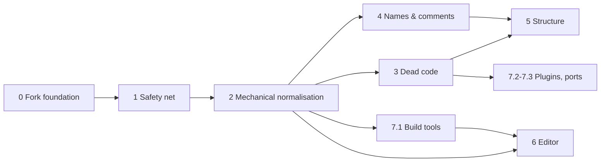

# AGS Draconian refactor plan

A staged plan for turning a codebase that grew from a 1990s DOS program into one that is
consistent, testable and easy to navigate, **without breaking the games built on it**.

- **Style rules:** [STYLE.md](STYLE.md)
- **Starting numbers:** [BASELINE.md](BASELINE.md), recomputed with `python Script/refactor_metrics.py`
- **Status:** tick the boxes in this file as tasks land, and reference the task ID (`3.2`) in commit
  messages and PRs.

## How to use this plan

The work is split into phases. Each phase has numbered tasks, and every task has a **done when**
line you can check. Phases 0–2 must be done in order and before anything else: they build the
safety net and the tooling. After that, phases 3–7 can overlap and be done **module by module**.
For example, `Engine/ac/overlay.cpp` can go through phase 4 while the Editor is still in phase 6.



Task 7.1 (the C++ build tools, D7) doesn't depend on phases 3–5 and can start right after phase 2.
The editor's switch to the tools (6.7d) waits for it.

Rough sizing, for one developer part-time: phases 0–2 take weeks, phases 3–4 take a few months,
and phases 5–6 are ongoing over a year or more. Each phase is useful on its own, so stopping
after any of them still leaves the code better than before.

Finished tasks keep their definition and a one-line result here; how they went (dated status,
measurements, bugs found on the way) is in [LOG.md](LOG.md).

## Ground rules

1. **It's a hard fork.** Upstream `adventuregamestudio/ags` is no longer merged wholesale. Fixes
   are cherry-picked by hand and recorded in `docs/UPSTREAM.md` (task 0.2). Being free of merges is
   what makes the reformat, renames and moves in this plan affordable, so make full use of it.
2. **The compatibility contract is sacred** (see below). Anything not on it may change freely.
3. **Safety net before surgery.** No structural change to a subsystem until phase 1 has given it
   tests that would catch a regression.
4. **One kind of change per commit** (STYLE.md, "Commits"): format, rename, move, delete, or
   behaviour. Mechanical commits are verified by object-code comparison (task 1.6).
5. **Ratchets, not big bangs.** CI enforces style on changed lines from day one. Metrics in
   BASELINE.md may only go down. A PR that makes a metric worse needs a stated reason.
6. **Boy-scout rule, with limits.** When you touch a function for a fix, you may rename its locals
   and fix its comments in a *separate* preceding commit. Don't refactor the surroundings in the
   same PR as the fix.
7. **Check upstream before designing.** Before a task that adds structure or an API, read
   `docs/context/decisions.md` and `roadmap.md`: if upstream has a design for the same thing, use
   its names and shape unless there is a stated reason not to, so the work stays portable
   (ALIGNMENT.md). Work meant for upstream is written in upstream's style and C++11 from the start.
8. **Lessons go into the docs, not the chat.** When a task fails, misleads or needs a trick, the
   fix goes into `AGENTS.md`, `STYLE.md` or `docs/context/` in the same session, so no later
   session repeats it.

## Compatibility contract

These interfaces are frozen unless a task explicitly versions them. Each one gets a guard test in
phase 1.

| # | Interface | Where it lives | Why it's frozen |
|---|---|---|---|
| C1 | Game data: `.ags`, `.crm`, sprite file + index, `.tra`, `.wfn`, **from 3.99 onward** (D1) | `Common/game/*`, `Common/ac/spritefile.*`, `Common/data/*` | Games built with 3.99/4.x editors must keep loading |
| C2 | Savegame format, for saves written by 3.99+ engines | `Engine/game/savegame*.cpp` | Players' saves of those games |
| C3 | Script ABI: exported API names and signatures, `game.*`/`system.*` field offsets, bytecode | `Register*API()`, `Engine/ac/dynobj/scriptgame.cpp` and friends, `Engine/script/scriptexecutor.cpp`, `Editor/AGS.Editor/Resources/agsdefns.sh` | Compiled game scripts link by name and offset |
| C4 | Plugin API: `IAGSEngine` vtable order, `AGS_Engine*` exports | `Engine/plugin/agsplugin.h` | Binary plugins built against the SDK |
| C5 | Editor project format (`Game.agf`, `.user`, room `.crm` source) and editor plugin API | `Editor/AGS.Types` | Existing projects and editor plugins |
| C6 | Engine command line and `acsetup.cfg` keys | `Engine/main/main.cpp`, `Engine/main/config.cpp` | Launchers, store builds, players' configs |

Note that C3 is defined by offsets and names, **not** by C++ struct layout. For example,
`GamePlayState` fields are read through the offset switch in `CCScriptGame::ReadInt32`, so
renaming or reordering the C++ fields is safe as long as that table stays correct.

## Purpose of the fork

This fork is a testbed for **AI-assisted refactoring**. That affects how the tasks are written:
each one should fit in a single session, have a "done when" line a machine can check, and be
backed by an automatic verifier (tests, the contract snapshots from 1.2, the object-code comparison
from 1.6, the metrics script). When a session starts a task, it should read `AGENTS.md`, "Next up"
and the task's section (not this whole file), STYLE.md, and finish by updating the checkbox and
"Next up". Upstream's intent lives in `docs/context/` (shared with upstream PR #3185); the fork's
plan against it is `ALIGNMENT.md` (2026-11-03).

## Decisions

Recorded 2026-10-31.

| ID | Question | Decision | Consequences | Unblocks |
|---|---|---|---|---|
| D1 | Oldest game version the fork must load (C1) | **3.99 and later** (`kGameVersion_399`) | All 3.x upgrade paths can go (task 3.4). Room versions need care, see 3.4. | 3.4 |
| D2 | Which platforms to ship on | **Windows, Linux, macOS, Android, Web, iOS.** Drop PSP. FreeBSD stays for now (small, shares the POSIX code). | iOS can't be tested locally (no Mac), so it gets a compile-only CI job (7.3) | 3.1, 7.3 |
| D3 | Keep the legacy script compiler? | **Remove `Compiler/script`** | `script2` becomes the only compiler (3.3) | 3.3 |
| D4 | Future of the Editor UI | **Avalonia is the main candidate.** The WinForms editor goes into maintenance mode. *Note 2026-11-03:* upstream plans no cross-platform editor and will not adopt one whole, but welcomes the core split (#1092, #3177); a-riddle-fan's `ags-for-mac` (3.6.x, .NET 10 + Avalonia, `AGS.Native` replaced by a CMake C library) exists and is studied before 6.7c (ALIGNMENT.md). | Editor work concentrates on a UI-free core shared by both UIs, and on replacing the C++/CLI bridge, which Avalonia can't use (phase 6) | 6.x |
| D5 | Single build system for native code | **CMake only.** MSBuild stays for the C# editor projects. | Hand-written Makefiles and the native `Solutions/*.vcxproj` go (3.2) | 3.2 |
| D6 | Minimum Windows version | **Windows 7+** | Drop `v141_xp`; `AGS.Native` targets `0x0601` instead of XP's `0x0501`; no APIs newer than Windows 7 without a runtime check | 0.4, 3.1 |
| D7 | How are games built, by the editor and headless? | **One build implementation, in C++: the tools in `Tools/`**, with `agsbuild` running `agf2dta`, `agscc`, `crmpak`, `po2tra`, `agspak` and the rest. The editor saves the project and runs `agsbuild`, or individual tools where it needs finer control. The C# build code (`DataFileWriter.cs`, `DialogScriptConverter.cs`, the C# script-header generation and translation writer, the C# preprocessor) is deleted once the tools reach parity. *Revised 2026-11-01 after maintainer review; replaces "one C# build core plus a C# command-line builder", which was argued from commit counts, a poor proxy for parity.* | Builds need only a C++ toolchain, so they run where .NET doesn't (Linux i386, which CI packages; FreeBSD, D2) and in CI without the editor. The game-data writer sits next to the engine's reader: same structs, testable with C++ round trips. Cost: `Game.agf` is read by both C# (editor) and C++ (`agfreader`), so a new project property needs a C++ change too; 7.1g makes a missed one fail tests instead of silently doing nothing. Starting point, measured 2026-11-01: the tools **can't build an AGS 4 project yet** (five gaps, listed in 7.1). | 1.7, 3.3, 6.3, 6.7d, 7.1 |

## Next up

Kept current as tasks land. Model and effort are recommendations for an AI session (see "Purpose
of the fork").

Done: phases 0 and 2, 7.1a–m and o, 3.3 (legacy compiler), U.1 (merged, #3181), U.2 (#3182, re-cut
into five branches by U.3), the agent docs (0.6, upstream PR #3185). Phase 1 is half done. Ground rule 3 applies from here: no
deletion (3.4) or restructuring (phase 5) before the safety net that guards it (1.2, 1.3). Reordered
2026-11-03 after reading upstream's plans (ALIGNMENT.md): upstream review latency is weeks, so the
offers (U.3) go out first and the fork-only divergence (3.2, 3.4, 5.3) comes after they are closed.

| # | Task | Why now | Model / effort |
|---|---|---|---|
| 1 | **U.3, remaining:** post ticket A (room compiler) and B (`po2tra`) and open PR 1 and PR 5 from the prepared branches (drafts in the session's scratchpad, see U.3 status); then PRs 2–4 as each base merges. `agsbuild` diagnostics on the Common log system (#2530) wait for ericoporto's logging change | Review takes weeks; the fork's tool work is only valuable upstream while #2316 is active | the user posts; Sonnet 5.5, `medium` for the follow-up rounds |
| 2 | **Commit 0.7 and 1.2's first part** (C2, C3, C5, the AGFReader tests; see 1.2 status), after the GCC-style check of the new tests (emsdk clang, see `ags-build-env`), the header check and a CI run; then **1.2, second part:** C1 fixtures, C4 test plugin, real 3.99/4.0 save fixtures | The safety net for 3.4 and phase 5 is half built and uncommitted | Sonnet 5.5, `medium` |
| 3 | **3.1:** remove PSP; delete the superseded `ags4-framescript` branch (upstream has `ViewFrame.EventName`/`OnFrameEvent`) | Small, safe, measurable | Sonnet 5.5, `medium` |
| 4 | **Pre-push check script:** clang-format, MSVC build + tests, MSBuild solutions, header check with MSVC and libc++ | CI should confirm, not discover (2.6 needed four pushes) | Sonnet 5.5, `medium` |
| 5 | **6.0 study:** read a-riddle-fan's `ags-for-mac` (`AGS.Types` diff, the C library that replaced `AGS.Native`) and #1092; decide which 6.0 steps are offered upstream and whether 6.7c reuses that library's surface | Two implementations of the same split would be waste; upstream welcomes exactly this | Opus 5.5, `high` |
| 6 | **1.3:** engine unit tests, starting with what needs no globals (route finder, `scsprintf`, sprite cache, VM with `script2` bytecode) | Needed before phase 5 and the savegame step of 3.4 | Opus 5.5, `xhigh` |
| 7 | **3.2a/b:** tool and engine Makefiles to CMake, Debian packaging | Fork-only; after U.3, because every port must re-add Makefile entries while the Makefiles exist upstream | Sonnet 5.5, `medium` |
| 8 | **2.4** clang-tidy gate, **1.5** sanitizers | Useful, not urgent; each adds CI time | Sonnet 5.5, `medium` |

Open items found while doing finished tasks (their details are in LOG.md): 0.4's CodeQL setting,
the `D3DCOMPILER_47`/Windows 7 question and the macOS 10.9 deployment target; 1.4's unfixed
`agfreader` crash on a project without `<Settings>` and `StrUtil::Unescape` reading past the end;
7.1f's "left open" notes (one test project measures parity; 8-bit games and old indexed
interactions unexercised).

3.2c (native `.vcxproj` to CMake) waits for 6.7: the C++/CLI bridge links against those libraries.
The rest of 3.3 (`AGS.CScript.Compiler`) waits for 6.7d. 5.3 (moving `Engine/ac` files) waits
until U.3 is closed and then uses upstream's draft directory names. The next big step after the
safety net is 6.7d (the editor builds through the tools).

---

## Phase 0: Fork foundation

- [x] **0.1 Tag the fork point.** Tag `fork-point` at `4cd88beba` (the current merge base with
  `upstream/ags4`). Keep the `upstream` remote for reference only.
  *Done when:* the tag exists and the README states the project is a hard fork.
- [x] **0.2 Cherry-pick ledger.** Create `docs/UPSTREAM.md`: a table of upstream commits that were
  picked, adapted or deliberately skipped. Every cherry-pick gets a line.
  *Done when:* the file exists and the cherry-pick process is described in CONTRIBUTING.md.
- [x] **0.3 Record decisions D1–D6** in the table above.
- [x] **0.4 Raise the toolchain floor.** `CXX_STANDARD 17` in all `CMakeLists.txt` (currently 11 in
  `Engine/` and `Common/`), `LanguageStandard stdcpp17` in all `.vcxproj`, `cmake_minimum_required`
  3.16+. For D6 (Windows 7+): replace the `v141_xp` toolset in `Solutions/Common.Lib` and the other
  projects with `v143`, and raise `WINVER`/`_WIN32_WINNT` in `Editor/AGS.Native/stdafx.h` from
  `0x0501` (XP) to `0x0601` (Windows 7). The Vista check in `Engine/platform/windows/acplwin.cpp`
  becomes always true and can go.
  *Done when:* CI is green on every platform with C++17, and no XP toolset or define remains.
  *Status:* done (2026-11-01) — see LOG.md.
- [x] **0.5 Repository hygiene.** Add the stray local artefacts (`Engine/resource/fxc*.exe`, `fxc.zip`,
  `Editor/References/x64/`) to `.gitignore` or commit them deliberately. Add a `.gitattributes` with
  `* text=auto` and `eol=crlf` only for `*.sln`, `*.bat`, `*.cmd`, `*.vcxproj*` and `*.csproj`.
  *Done when:* `git status` is clean after a full Windows build.
- [x] **0.6 Agent context docs.** `AGENTS.md` (fork rules and facts) and `docs/context/`
  (upstream's repository map, workflows, decisions, roadmap, sources; every claim dated and
  sourced), written for tools, ≤3k tokens per file. The same `docs/context/` is offered upstream
  (PR #3185, 2026-11-03) and is kept identical to it; fork-specific knowledge goes into
  `AGENTS.md` and `ALIGNMENT.md`, never into `docs/context/`.
  *Done when:* a session can answer "what does upstream intend here" from the docs without
  searching issues. *Refresh:* `roadmap.md` at each upstream milestone change, `decisions.md`
  when a maintainer settles something (rules in `docs/context/README.md`).
- [x] **0.7 Move status logs out of this file.** The "*Status*" paragraphs of finished tasks go to
  `LOG.md` (one dated entry per task, same text), leaving each task here as description,
  "done when" and a one-line result. Keep the "Found on the way" bugs and lessons: they are the
  useful part, move them with the entry.
  *Done when:* this file is under 8k tokens and `LOG.md` holds every removed paragraph verbatim.
  *Status (2026-11-03):* done; 1372 lines, 114240 bytes (~28.6k tokens) -> 910 lines, 72.1k bytes (~18.0k tokens); LOG.md holds the removed paragraphs (574 lines).

Today: 35 C++ test files, but **only 3 for the engine** (~430 source files). The 22 C# test files
cover `AGS.Types` and a few editor utilities. The end-to-end coverage comes from the upstream
auto-test game that CI downloads from `latest`.

- [x] **1.1 Own the auto-test game.** CI downloads `ags-test-games/releases/latest` from upstream.
  After the fork this will start failing for reasons that have nothing to do with your code. Fork
  `ags-test-games`, pin a tag in `build.yml`, and add tests there for every Draconian-only feature
  (D3D11 driver, custom shaders, full ranges, dirty rects, ...).
  *Done when:* CI pins a fork-owned test-game version that covers fork-specific features.
  *Status:* done (2026-11-01) — see LOG.md.
- [ ] **1.2 Contract guard tests** (one per row of the compatibility contract):
  - C1: load fixture game files and rooms written by a 3.99 editor, the earliest 4.0 editor you can
    get, and the current one, and assert on counts and names (fixtures go in `Common/test/data/`, as
    small as possible). Record each fixture's room-file version number; task 3.4 needs it.
  - C2: savegame **round trip**: load save → write save → byte-compare, plus loading saves produced by
    a 3.99 engine and the last released 4.0 engine.
  - C3: a test that dumps the exported API table (`--print-scripttoc` already exists) and compares it
    with a checked-in snapshot. Any change to the snapshot must be deliberate.
  - C4: a minimal test plugin that calls every `IAGSEngine` method.
  - C5: Editor: open → save a sample `Game.agf` and compare the XML. `Game.agf` has two readers
    (D7), so the same sample is also loaded by `Tools/data/agfreader` with no unknown-element
    warnings (7.1g).
  *Done when:* each contract has a test that fails if it's broken.
  *Upstream (2026-11-03):* C5 and the AGFReader tests are what #3147 asks for, C2 is #2814's
  5-step plan (generate data, save, restore into a second instance, compare). Write those two in
  upstream style (C++11, existing test targets) in the `ags4-upstream` worktree first and port
  them here, not the other way round.
  *Status (2026-11-03):* C2, C3 and C5 done; C1 and C4 open. Nothing committed yet.
  - **C3:** `Engine/test/script_exports_test.cpp` (new CMake target `engine_full_test`, since
    `engine_test` stubs `cc_error`/`debug_script_event` and can't link the whole engine) registers the
    current API with `setup_script_exports` and compares every exported symbol (`name kind plugin|-`,
    1635 lines: 518 functions, 1114 methods, 3 objects) with `Engine/test/data/script_exports.txt`;
    regenerate with `AGS_UPDATE_SNAPSHOTS=1`. `--print-scripttoc` dumps a compiled script, not the
    API, so it wasn't reused. Not covered: `game.*`/`system.*` field offsets, signatures beyond the
    `^N` argument count.
  - **AGFReader per-block tests** (= #3147): written upstream-first on worktree branch
    `ags4-agfreader-tests` (`26db161ed`, 47 tests, C++11, XML string → parser, no files; upstream
    `tools_test` 124 of 124), checked on `ags4-tools-2-agfreader` too (139 of 139), then ported to
    `Tools/test/agfreader_test.cpp` (AGS 4 element names, `Opacity`). They document the upstream
    reader's drift from the editor (`Name`/`ScriptName`, `Description`/`DisplayName`, `RealName`,
    `Flipped`/`Flip`, interactions' `ScriptModule`, audio folder defaults, `LATEST_XML_VERSION`
    3.0.3.2), all fixed on `ags4-tools-2-agfreader`.
  - **C5:** `Editor/AGS.Editor.Tests/Types/GameXmlRoundTripTests.cs` loads `Tools/test/data/Game.agf`
    (the auto-test project trimmed to ~80 KB, plus properties, a plugin, array variables; nothing
    private), saves it and compares the `<Game>` XML (only `<BuildTargets>` normalised: the editor
    filters it by registered targets); regenerate with `AGS_UPDATE_GAME_SAMPLE=1`. The same sample is
    read by `AGFReaderSample.*` in `tools_test` with `XmlProblems` empty (`agf2dta --strict`'s
    check) and entity counts. Mutations (a deleted element, an injected `<Unknown>`) fail both sides.
  - **C2:** upstream-first on worktree branch `ags4-save-roundtrip` (`196a0fadb`, target
    `savegame_test`, 6 tests), ported to `Engine/test/savegame_test.cpp` (`engine_full_test`): ~16
    `play` fields written with `SavegameComponents::WriteAllCommon`, cleared, restored with `ReadAll`,
    written again: state restored and the two saves byte-identical; plain and compressed agree; each
    of the 14 components round-trips alone; a truncated save is refused. **Gaps:** the script
    component is skipped (`gamescript` is null without a loaded game: access violation), rooms,
    characters, GUIs and views only in their default state, `DoBeforeRestore`/`DoAfterRestore` not
    exercised; no real 3.99/4.0 save fixtures exist yet. `savegame_internal.h` isn't self-contained.
  - Measured: fork ctest 874 of 874 (`tools_test` 167, `engine_full_test` 7), NUnit 394 of 394.
    Not verified: GCC/Clang builds and the header check for the new tests, MSBuild `Tests.sln` (the
    new C++ tests are CMake-only), CI, macOS/Linux.
  - Left for the second part: C1 (fixtures from a 3.99 and an early 4.0 editor), C4 (the test
    plugin), real save fixtures for C2, and sending `ags4-agfreader-tests` (#3147) and
    `ags4-save-roundtrip` (#2814) upstream after the `ags4-tools-*` PRs.
- [ ] **1.3 Engine unit tests for the riskiest subsystems**, in this order: script VM
  (`ScriptExecutor` with bytecode produced by `script2`), route finder, overlay/GUI layout
  arithmetic, savegame components, string formatting (`scsprintf` already started), sprite cache
  eviction. Where a subsystem reads globals, add a test fixture that sets them up. That fixture is
  the first step towards phase 5's context object.
  *Done when:* each listed subsystem has a test file. Engine test files ≥ 15.
- [x] **1.4 Game corpus regression.** A script (`ci/corpus/run.py`) that, for each game you own the
  sources to: compiles all scripts with `script2` (before 3.3 removes the legacy compiler, run it
  once with both and confirm every game builds with `script2`); runs the engine with
  `--gfxdriver Software --no-message-box --log-stdout` through `--startr N` for every room;
  and fails on warnings or crashes. Run it locally before risky merges and in CI nightly if the game
  data can live in a private repo.
  *Done when:* one command runs the whole corpus and reports pass/fail per room.
  *Corpus (2026-11-02):* one private AGS 4 game built on this branch (project format 4.0.0.34,
  53 rooms, 36 scripts, 1.6 GB); another can be prepared on request. Game paths are personal: the
  script takes them from its arguments or a git-ignored file under `.compare/`, never from the repo,
  and works on a copy (the editor's `/compile` writes into the project). For AGS 4 projects the
  `script2`-vs-legacy step is likely moot (the legacy compiler predates AGS 4 syntax); confirm once.
  *Status:* done (2026-11-02) — see LOG.md.
- [ ] **1.5 Coverage, sanitizers and warnings.** Add a Linux CI job with `-fsanitize=address,undefined`
  running all unit tests and the auto-test game, and a coverage job (`llvm-cov`) that publishes
  per-directory numbers. Raise first-party warning levels to `/W4` and `-Wall -Wextra`, warnings as
  errors **per directory** as each directory gets clean.
  *Done when:* the sanitizer job is green, the coverage report is published, and `Common/` builds with
  warnings as errors.
- [x] **1.6 Mechanical-change verifier.** `Script/compare_objects.py`: build Release without debug
  info into two trees (before and after a commit), strip the objects and hash them. Report
  translation units that differ. Format-only and rename-only commits must come out identical except
  for files that use `__LINE__`/`__FILE__`. This makes phases 2 and 4 nearly risk-free.
  *Done when:* the script exists and is documented in STYLE.md, "Commits".
  *Status:* done (2026-11-01) — see LOG.md.
- [x] **1.7 Build the auto-test game in CI, from source.** Done as part of 7.1j: once `agsbuild`
  builds AGS 4 projects, a Linux job compiles `AlanDrake/ags-test-games` (pinned commit) with the tools
  built in the same run and hands the result to the platform jobs. That replaces the hand-made
  releases from 1.1, keeps the test game in step with this commit's compiler, and doesn't tie every
  platform job to the Windows editor build (the earlier plan: compile with the CI-built editor).
  Until then, keep publishing `draconian-auto-test-N` releases by hand.
  *Done when:* the platform jobs run a test game compiled by tools of the same CI run.
  *Status:* done (2026-11-02) — see LOG.md.

## Phase 2: Mechanical normalisation

The configs are already in the repo: `/.clang-format`, `/.clang-tidy`, `/.editorconfig`, plus
`DisableFormat` stubs in the third-party folders. Measured clang-format 19 churn is about 15% of
lines (BASELINE.md). Most of it is real fixes: K&R braces → Allman, `if (x) y;` split onto two
lines, tab-indented code.

- [x] **2.1 CI format gate.** A job that runs pinned `clang-format 19` via `git clang-format --diff`
  against the PR base and fails if anything changes. Changed lines only, from day one.
  *Done when:* a PR with a badly formatted line fails CI.
- [x] **2.2 One-time reformat, module by module.** Commits like `Common: [format] whole module`,
  then Compiler, Tools, Engine (split by subfolder), Plugins (first-party only), Editor/AGS.Native.
  Verify each with 1.6. Add every hash to `.git-blame-ignore-revs` and run
  `git config blame.ignoreRevsFile .git-blame-ignore-revs`.
  *Done when:* `clang-format --dry-run` reports nothing on first-party code, and CI switches to
  checking whole files.
  *Status:* done (2026-11-01) — see LOG.md.
- [x] **2.3 Mechanical modernisation** (each item is its own commit, using the clang-tidy `--fix`
  of the named check): `NULL` → `nullptr` (276), `modernize-use-override`,
  `modernize-deprecated-headers` (`<math.h>` → `<cmath>`), `modernize-use-using`,
  `modernize-redundant-void-arg`.
  *Done when:* those checks are clean, so they move from "changed lines" to "whole tree" in CI.
  *Status:* done (2026-11-01) — see LOG.md.
- [ ] **2.4 clang-tidy gate.** Generate `compile_commands.json` in the Linux CI job and run
  `clang-tidy-diff.py` on the PR diff with the root `.clang-tidy`. This enforces naming and
  function-size rules on new code without touching the old code.
  *Done when:* a PR that introduces a `chaa`-style name or a 300-line function gets flagged.
- [x] **2.5 Header guards → `#pragma once`** (372 headers use `__AGS_...` guards, which are reserved
  identifiers) and **remove `using namespace` from headers** (54). The latter isn't purely mechanical:
  every `.cpp` that relied on it needs its own `using` or qualification. Do it one header at a time.
  *Done when:* both metrics are 0.
  *Status:* done (2026-11-01) — see LOG.md.
- [x] **2.6 Self-contained headers, then sorted includes.** Add a CMake target that compiles each
  first-party header on its own (`header_check_<name>.cpp` that includes only that header). Fix
  failures with includes or forward declarations, then set `SortIncludes: CaseSensitive` with
  `IncludeCategories` matching STYLE.md and reformat once more.
  *Done when:* the header-check target builds and include order is enforced. This also helps
  compile times: `character.cpp` includes 57 headers and `game.cpp` 74.
  *Status:* done (2026-11-02) — see LOG.md.
- [x] **2.7 Line endings.** Renormalise with the `.gitattributes` from 0.5 (`git add --renormalize .`)
  in one commit, listed in `.git-blame-ignore-revs`.
  *Status:* done (2026-11-01) — see LOG.md.

## Phase 3: Dead code removal

Remove first and restructure after: deleting code first makes everything later smaller. Each
removal is a `[delete]` commit, verified by the full test suite and the corpus run (1.4).

- [ ] **3.1 Dead platforms** (D2, D6): the `PSP/` folder, `Engine/Makefile.psp`, every plugin
  `Makefile.psp` and `psp.c`, `Engine/util/library_psp.h`, the 8 `AGS_PLATFORM_OS_PSP` branches, and
  any pre-Windows 7 code paths and toolsets. iOS and FreeBSD stay.
  *Done when:* `AGS_PLATFORM_OS_PSP refs` = 0 and the folders are gone.
- [ ] **3.2 Duplicate build systems** (D5): delete `Engine/Makefile*`, `Compiler/Makefile`, plugin
  `Makefile`/`Makefile-objs`, and `.github/workflows/makefile-build.yml`. Make sure the CMake build
  covers what `debian/` packaging needs. Move the native `Solutions/*.vcxproj` to CMake-generated VS
  solutions (CMake's VS generator, or CMake presets) so a source file is listed in exactly one place.
  The C# and C++/CLI editor projects stay in MSBuild.
  Found 2026-11-02, older than phase 2: the `Linux Tools` and `macOS Tools` jobs build with the tool
  Makefiles through `find Tools -name Makefile -execdir make ... \;`, which exits 0 whatever `make`
  returns. Six tools fail and are silently missing from the archives: `agf2dlgasc`, `agfexport`,
  `agsbuild` (no `xml_fields.cpp` in their Makefiles), `agf2dta` (no `libsrc/glm` include path),
  `crmpak`, `spriteimport` (list `Common/game/interactions.cpp`, which no longer exists). Build these
  jobs with CMake (`-DAGS_BUILD_TOOLS=1 -DAGS_BUILD_ENGINE=0`, as the `Auto-test game` job does)
  when the tool Makefiles go.
  *Done when:* adding a `.cpp` file to the engine means editing one file.
- [ ] **3.3 Legacy compiler** (D3; run 1.4 once first): remove `Compiler/script/` (≈6.5k lines, including the
  1,477-line `__cc_compile_file`), `Compiler/test/` tests that only target it,
  `Solutions/Compiler.Lib`, `ccCompileText` in `AGS.Native/ScriptCompiler.cpp`, the
  `ExtendedCompiler` setting and editor UI, and fold `test2/` into `test/`.
  Then remove **`Editor/AGS.CScript.Compiler`**. Its compiler parts (tokenizer, code generator,
  `ScriptCompiler.cs`, most of `Entities/`) were never finished and nothing uses them. Its
  **preprocessor is used** by the editor's build today (`AGSEditor.cs`, `CompilerFactory.CreatePreprocessor`),
  and it has drifted from the C++ one in `Compiler/preproc` (it knows `#module`, the C++ one doesn't).
  So the order is: port its C#-only features to the C++ preprocessor (7.1c), switch the editor's
  build to the tools (6.7d), move the few types the editor uses (`CompilerMessage`, `FastString` for
  autocomplete, `ScriptAnnotations`) into the editor, move `PreprocessorTests.cs` cases to C++
  tests, then delete the project.
  *Done when:* one compiler, one preprocessor (C++), one test folder, and no `AGS.CScript.Compiler`.
  *Status (2026-11-03):* the legacy compiler is gone; `AGS.CScript.Compiler` waits for 6.7d.
  See LOG.md for the details of the removal and its verification.
- [ ] **3.4 Legacy data-version paths** (D1: 3.99+ only). This is the largest single deletion in the
  plan. Work in this order, one commit per step:
  1. **Game files.** Set `kGameVersion_LowSupported = kGameVersion_399` in
     `Common/ac/game_version.h`, then delete every branch that can now only run for older data: the
     `Upgrade*()` functions in `Common/game/main_game_file.cpp`, comparisons against
     `kGameVersion_3xx` constants older than 399 (62 `legacy version checks` in BASELINE.md, in 22 `.cpp` files across
     `Common/gui`, `Engine/ac`, `Engine/game` and `Engine/main`), and the
     `loaded_game_file_version` checks they guard. Then remove the obsolete enum values themselves.
  2. **Room files: careful.** Room versions are not monotonic. `kRoomVersion_399 = 40` sorts *below*
     the 3.6.x versions (`kRoomVersion_363_06 = 36306`), so raising `kRoomVersion_LowSupport` to
     `kRoomVersion_399` would make 3.6.x rooms look newer than 3.99 ones. Use the fixture versions
     recorded in 1.2 to see which values 3.99/4.0 editors actually wrote. Then replace the numeric
     minimum with an explicit check for those versions, and only after that delete the `ReadExt_*`
     and upgrade code for older rooms.
  3. **Savegames.** Raise `kSvgVersion_LowestSupported` (currently `kSvgVersion_Components`, a 3.x
     version) to the oldest version a 3.99 engine writes, and delete the branches below it.
  4. **Script API.** Delete `*_Old` variants (e.g. `Character_GetHasExplicitTint_Old`) and
     compatibility registrations that exist only for pre-3.99 scripts. Check the C3 snapshot after
     each deletion: anything a 3.99+ game can still call must stay.
  5. Deprecated savegame-only fields (`gscript_timer`, `replay_hotkey_unused`, ...) go **at the next
     savegame format bump only**, since C2 still applies to 3.99+ saves.
  *Done when:* `legacy version checks` = 0, the C1/C2 fixture tests pass, and loading a 3.6 game
  fails cleanly with a "game too old" error instead of crashing.
- [ ] **3.5 Unused functions.** `refactor_metrics.py --list-dead 200` lists 154 *candidates*. Many are
  false positives: plugin-API vtable entries, functions called from Java/Obj-C on mobile, or functions
  only referenced by name strings. Confirm each with a Linux build using
  `-ffunction-sections -fdata-sections -Wl,--gc-sections,--print-gc-sections` and `-Wunused-function`,
  then delete in batches per directory.
  *Done when:* the candidate list contains only documented intentional exceptions.
- [ ] **3.6 Comment debris.** Delete commented-out code (83 lines, mostly in the compiler tests, `Compiler/test`).
  Triage the 735 `TODO` / 332 `FIXME` / 80 `CHECKME` markers: either resolve, reclassify as
  `FIXME` / `TODO` per STYLE.md, or delete if stale. Do this per directory alongside phase 4.
  *Done when:* no `CHECKME` / `HACK` remain in a cleaned directory, and every `FIXME` says what
  case is wrong.
- [ ] **3.7 Obsolete API stubs.** `Engine/plugin/plugin_stubs.cpp` (223-line `RegisterPluginStubs`)
  keeps games that reference long-dead plugins (snow/rain, etc.) running. Keep the stubs your games
  need and drop the rest. `Common/util/wgt2allg.*` (the DOS WGT graphics shim, 6 includes) should be
  folded into `BitmapHelper` and deleted.

## Phase 4: Names and comments

This phase is done **file by file**, starting with the files that change most often (high churn
gives the best return). Each file gets a `[rename]` commit verified by 1.6, then optionally a
`[comments]` commit.

- [ ] **4.1 Parameter and local names.** Drive the watchlist in `refactor_metrics.py` to zero
  (4,855 occurrences today): `chaa` 652, `eres` 445, `chi` 368, `objj` 335, `sds` 226, `tqs` 224,
  `guio` 220, `butt` 187, `chin` 126, `char1` 98, `chap` 88, `scam` 82, `texx` 68... Use one name per
  concept across the codebase (`ch` for `CharacterInfo*`, `obj` for `RoomObject*`, `gui` for
  `GUIMain*`, `btn` for `GUIButton*`, `ds` → `dst` for destination bitmaps, `err` for error results).
  Use IDE rename or clang-based renaming, never search-and-replace.
  *Done when:* the cryptic-names total is 0, except for the globals handled in 5.1.
- [ ] **4.2 Function names.** Engine free functions are a mix of `snake_case` (949),
  `PascalCase` (1,094) and `Type_Method` (3,119, the script API). Rename the snake_case ones to
  PascalCase as their files are restructured in phase 5; don't do it earlier, since many of them
  will be deleted or moved into classes.
- [ ] **4.3 Field names of legacy structs.** `GamePlayState` (`play`), `GameSetupStruct` (`game`),
  `CharacterInfo`, `RoomStatus`, etc. use DOS-era lower-case names (`usedmode`,
  `disabled_user_interface`, `messagetime`). Rename to the STYLE.md form per struct. The script ABI
  maps by offset (C3), so this is safe. Keep each renamed field's original script-facing name in a
  trailing comment if it differs.
- [ ] **4.4 File names.** Rename files to `snake_case` matching their main class
  (`gamesetupstruct.cpp` → `game_setup_struct.cpp`, or whatever the type becomes in phase 5). Use
  `[move]` commits (rename only, no content change, so git tracks history) and do them together with
  the directory moves in 5.3 so files move only once.
- [ ] **4.5 Comments.** For each file touched in 4.1: remove history notes and author tags, fix
  comments that describe old behaviour (watch for references to DOS, palettes in 32-bit paths,
  removed functions and old version numbers), and add a header comment to every public function.
  Each top-level directory gets a short `README.md`: what it's for, its main entry points, and what
  must not depend on it.

## Phase 5: Structure

This is where the maze gets straightened out. Each task here is a series of small PRs, not one
big one.

- [ ] **5.1 Collect the globals.** 704 `extern` declarations in `Engine/`, 596 of them written inline
  in `.cpp` files. The most-shared globals are `game` (67 files), `thisroom` (31), `spriteset` (31),
  `gfxDriver` (28), `displayed_room` (20), `views` (18), `croom` (18), `playerchar` (17),
  `palette` (15), `platform` (13), `scsystem` (10) and `objs` (10). Steps:
  1. Every global is declared in exactly one header owned by its module. `extern` in `.cpp` files
     → 0.
  2. Group them into a few context structs, named as upstream's #2058 names them so the two
     trees stay recognisable: `GameData` (loaded, static data: `GameSetupStruct` plus the lists of
     data structs), runtime `Game` (`GameData` + `GameState` + the runtime object lists, e.g.
     `Character` = `CharacterInfo` + `CharacterExtras`), the current room, and an `EngineServices`
     struct for the gfx driver, audio, platform and sprite cache (no upstream name yet), each
     with a single accessor.
  3. New and refactored functions take the context they need as a parameter. The phase 1 fixtures
     construct these contexts directly, which is what makes engine code unit-testable.
  *Done when:* `extern decls in Engine .cpp files` = 0 and the top 12 globals are reached only
  through the context accessors.
- [ ] **5.2 Separate script bindings from logic.** There are 1,598 hand-written `Sc_*` wrappers,
  built from 147 `API_*` macros in `script_api.h`, and they're interleaved with game logic (for
  example `character.cpp`, 5,092 lines, whose last ~1,400 lines are bindings plus a 228-line
  `RegisterCharacterAPI`). Steps:
  1. Move each file's `Sc_*` block and `Register*API` into `Engine/script_api/<type>_api.cpp`
     (a `[move]` commit).
  2. Replace the macros with a C++17 template binder that deduces arguments from the
     implementation's signature, e.g.
     `api.Method<&Character_AddInventory>("Character::AddInventory^2")`. Generate the
     parameter-count check from the signature. Guarded by the C3 snapshot test (1.2).
  *Done when:* no `Sc_` function remains, and `script_api.h` only has the binder.
- [ ] **5.3 Reorganise `Engine/ac/`.** "ac" (the original program name, *Adventure Creator*) is a
  64k-line catch-all holding 145 files. Proposed target layout (adjust as you go; the
  principle is one folder per domain, with logic separate from script bindings):

  | New folder | Moves from `Engine/ac/` |
  |---|---|
  | `Engine/world/` | character*, object, roomobject, roomstatus, room, hotspot, region, walkablearea, walkbehind, inventoryitem, properties, movelist |
  | `Engine/navigation/` | route_finder*, path_helper, pathfinder_script |
  | `Engine/dialog/` | dialog, dialogoptionsrendering, parser |
  | `Engine/presentation/` | display, speech, overlay, screenoverlay, draw*, screen, viewframe, lipsync, dynamicsprite, drawingsurface |
  | `Engine/ui/` | gui, guicontrol, button, label, listbox, slider, textbox, invwindow, guiinv, mouse |
  | `Engine/input/` | sys_events, joystick, touch |
  | `Engine/script/dynobj/` | `ac/dynobj/*` (managed script objects, next to the VM that owns them), scriptcontainers |
  | `Engine/audio/` | audiochannel, audioclip, global_audio (next to existing `Engine/media/audio`) |
  | `Engine/script_api/` | all `Sc_*`/`Register*API` (5.2), `global_api.cpp`, `utils_script`, `video_script`, `viewport_script`, `shader_script` |
  | `Engine/runtime/` | game, gamestate, event, timer, system, translation, file, datetime, math, string |

  The 14 `global_*.cpp` files are the old flat script API (`Display()`, `SetGlobalInt()` and friends).
  Fold whatever is still used into its domain folder and delete the rest. `Common/ac/` gets the
  same treatment (`Common/game/`, `Common/assets/`).
  *Upstream (2026-11-03):* the wiki draft "AGS 4 Draft: major engine refactor" proposes
  `system/main/script/data/game/gfx/audio/video/util`; nothing is decided there. File moves are
  what hurts `port.py` most, so this task waits until U.3 is closed and then prefers upstream's
  names where the two layouts overlap (`game/` for the world folder, `script/` for the VM,
  `gfx/`, `audio/`, `util/`); the finer split (`navigation/`, `dialog/`, `ui/`) stays fork-only.
  *Done when:* `Engine/ac/` no longer exists.
- [ ] **5.4 Split the longest functions** (top of the BASELINE.md list), each with tests first:
  - `display_speech` (489 lines, nesting 8): split into text layout, portrait/bubble placement,
    lip-sync setup, and the blocking wait loop.
  - `load_new_room` (408): split into loading data, resetting state, and running room scripts and
    events.
  - `ScriptExecutor::Run` (1,161): an interpreter loop, so the long switch is expected. Move each
    opcode family into an inline handler, and benchmark before and after; the corpus run (1.4) is
    the reference.
  - `GamePlayState::ReadFromSavegame`/`WriteForSavegame` (303/215), `RoomObject`, `CharacterExtras`
    and `ScreenOverlay` serialisers: generate them from one field list (a serialisation helper or an
    X-macro) so reading and writing can't drift apart. Guarded by the C2 round-trip test.
  - `engine_init_game_settings` (265), `DialogOptions::Begin/Run`. (`BuildWithTaskManager` in
    `agsbuild`, 535 lines, is split as part of 7.1i.)
  *Done when:* functions over 200 lines: 19 → 3 at most (with the interpreter loop as a documented
  exception), and nesting ≥ 6: 10 → 0.
- [ ] **5.5 Confine Allegro.** The trimmed Allegro 4 fork (`libsrc/allegro`, ≈15k lines of C) is
  only needed as a pixel-buffer and blitter backend. Make `Common/gfx/allegrobitmap.*` and
  `Common/gfx/blender.*` the only files that include `allegro.h` (38 includes today), then decide
  whether to replace the backend with a small `Bitmap` implementation of your own. The tests from
  1.3 (`bitmapdata_test`, `paletteop_test`) and software-renderer screenshots guard this.
  *Done when:* `allegro.h includes` ≤ 3.
- [ ] **5.6 Error handling.** Replace the 179 `quit("...")` calls in subsystems with `HError` returns propagated to
  the main loop (STYLE.md). Start with file and asset loading, where a bad game file should produce a
  diagnostic instead of an abort.
- [ ] **5.7 Common C leftovers.** Replace fixed `char[N]` buffers (123) and
  `sprintf`/`strcpy`/`strcat` (63) with `String`, and raw `new[]`/`delete[]` (76) and
  `malloc`/`free` (51) with containers or smart pointers, except at C API boundaries (plugin API,
  SDL, OpenAL), which must be commented.

## Phase 6: Editor

The editor is ~107k lines of C# on .NET Framework 4.7 with C# 6, plus the C++/CLI bridge
`AGS.Native` (`agsnative.cpp` is 3,668 lines).

Per D4, the WinForms editor goes into **maintenance mode** and Avalonia is the planned UI. So the
editor work is about preparing a UI-independent core that a future Avalonia front end can use.
WinForms panes get bug fixes but no polish. Two things block Avalonia today:

- The project model (`AGS.Types`) and editor logic target .NET Framework 4.7, and Avalonia needs
  modern .NET.
- `AGS.Native` is C++/CLI, which only runs on Windows and is tied to .NET Framework.

Tasks 6.0, 6.1, 6.3 and 6.7 remove those two blockers. The remaining tasks improve quality along the way.

- [ ] **6.0 Make `AGS.Types` UI-free.** It's meant to be the project model, but today it depends on
  the WinForms UI: 17 files use `System.Windows.Forms`, 121 `[Editor(typeof(...))]` /
  `[TypeConverter(typeof(...))]` property-grid attributes reference WinForms editor classes, and the
  model stores `System.Drawing` `Font` (55 references) and `Bitmap` (15) objects. Those two types
  are Windows-only on .NET 6+. `Color`, `Point`, `Size` and `Rectangle` are fine, since they're
  cross-platform in .NET 8. Steps:
  1. Switch property-grid attributes to their string constructors
     (`[Editor("AGS.Editor.SpriteSelectUIEditor, AGS.Editor", "System.Drawing.Design.UITypeEditor")]`),
     which removes the compile-time dependency, and move the editor classes into the WinForms assembly.
  2. Replace `Font`/`Bitmap` fields with plain data (font file + size + style, sprite number, image
     path), and create the `System.Drawing` objects in the UI layer.
  3. Move anything else that needs WinForms out of `AGS.Types`.
  The model must load and save the same `Game.agf` as before (C5 round-trip test, 1.2).
  *Done when:* `AGS.Types` has no reference to `System.Windows.Forms`, `System.Drawing.Common` or
  `System.Drawing.Design`, and its tests pass on Linux.
- [ ] **6.1 SDK-style projects.** Convert the `.csproj` files to SDK style. Use `PackageReference`
  instead of `packages.config`. The WinForms application keeps targeting `net48` (still supported on
  Windows 7 SP1, D6), with `LangVersion` 7.3, the highest C# version officially supported on .NET
  Framework. Libraries that hold no UI code (`AGS.Types` and the new core from 6.3; not
  `AGS.CScript.Compiler`, which 3.3 deletes) **multi-target `netstandard2.0` and `net8.0`**, so both
  the WinForms editor and a future Avalonia editor can reference them.
  *Done when:* `dotnet build` builds the C# projects, the existing tests pass, and `AGS.Types` builds
  for `net8.0` (needs 6.0 first).
- [ ] **6.2 Format and analyzers.** Run `dotnet format` once per project (`[format]` commits,
  `.git-blame-ignore-revs`), then raise the `.editorconfig` severities from `suggestion` to
  `warning`, and enable `EnforceCodeStyleInBuild`.
- [ ] **6.3 Pull logic out of the big UI classes.** `RoomsComponent.cs` (3,113 lines),
  `ScintillaWrapper.cs` (3,040), `GUIController.cs` (2,120), `SpriteSelector.cs` (2,045) and
  `AGSEditor.cs` (1,920) mix UI with project logic. Move the non-UI parts into a new
  `AGS.Editor.Core` assembly (`netstandard2.0` + `net8.0`, no `System.Windows.Forms` or
  `System.Drawing` reference), which the Avalonia editor will build on, and test them there. Start
  with project load/save and upgrade (`UpgradeGameManager`), because those have no UI and are what an
  Avalonia editor needs first. The build itself does **not** move here: per D7 the editor runs the
  C++ tools (6.7d), so `Tasks.cs` and `BuildTargets/` shrink to "save, run `agsbuild`, show results".
  *Done when:* loading, saving and upgrading a project works from a headless test with no WinForms
  loaded.
- [ ] **6.4 Dependency injection over `Factory`.** 965 references to the static `Factory` service
  locator. Introduce constructor parameters for new and refactored classes and keep `Factory` as the
  composition root only.
- [ ] **6.5 Exceptions.** Triage the 122 catch-all handlers: narrow the exception type, log, or
  rethrow. An editor that silently swallows I/O errors can corrupt projects.
- [ ] **6.6 Editor tests.** Extend `AGS.Editor.Tests`: project load/save round trip (C5) and the
  upgrade path for old projects (`UpgradeGameManager`). `DataFileWriter` (2,551 lines) needs no new
  unit tests: until 6.7d deletes it, the build-parity harness (7.1a) compares its output with the
  tools' output file by file.
- [ ] **6.7 Replace the C++/CLI bridge with C# plus a small C library.** `AGS.Native` (~6,800 lines
  of C++/CLI) is **not** converted to C# wholesale. Two of its parts must stay native: font and GUI
  rendering (previews must be pixel-identical to the engine), and room/sprite file I/O for editing
  (shared with the engine and the tools; the fork changes these formats, so a C# copy would need
  every change made twice). Compiling leaves the editor process entirely: scripts compile in `agscc`
  as part of the build (D7). Everything else either goes away or becomes C#. Current contents:

  | Part | ~Lines | Fate |
  |---|---:|---|
  | Glue between C# and C++ types: bitmap, GUI, room, interaction and custom-property conversion, the `NativeMethods` managed API, `NativeRoom` | 2,400 | Disappears; what's still needed is rewritten in C# against the C library |
  | Import of old compiled games: `ImportOldGameFile`, `import_compiled_game_dta`, `load_dta_file_into_thisgame`, `init_game_after_import`, SCI font import | 650 | Deleted (D1) |
  | Editor-only utilities: template extraction, ini read/write, exe icon writing (`agsicons.cpp`), native constants | 550 | Ported to C# |
  | Room and sprite file I/O wrappers (over ~4k lines in `Common/`) | 1,100 | Stays native, behind the C library |
  | Font and GUI rendering wrappers (over ~8k lines in `Common/font`, `Common/gui`) | ~500 | Stays native, behind the C library |
  | View loop and sprite drawing (`doDrawViewLoop`, `drawSprite*`) | ~150 | **Moves to the UI.** `doDrawViewLoop` redraws the whole loop into one surface on every paint, with no caching, which also keeps the view editor from redrawing one frame. Frames are plain sprites: the UI paints them frame by frame from cached sprite bitmaps and does scaling and flipping itself. |
  | Script compiler glue (`ScriptCompiler.cpp`) | 300 | Goes away: the build compiles with `agscc` (D7). Add an in-process entry point to the C library only if an in-editor check turns out to need one. |

  Steps, each a separate PR, with the C++/CLI bridge kept working until the last one:
  - [ ] **6.7a Delete the old-game import** and the editor menu entries that use it.
  - [ ] **6.7b Port the editor-only utilities to C#.** Template files are AGS multi-file libraries, so
    the C# reader needs tests against templates written by the C++ code. Icon writing uses the Win32
    `BeginUpdateResource`/`UpdateResource` API through P/Invoke. It only matters for Windows builds of
    the game and can stay Windows-only.
  - [ ] **6.7c Define the C library (`ags_editor_native`).** *Prerequisite (2026-11-03):* the
    6.0 study in "Next up": `ags-for-mac` already replaced `AGS.Native` with a C library built by
    CMake from `Common/` and `Engine/` on 3.6.x; reuse its surface where it fits so that one
    library can serve both editors, and so the split can be offered upstream (#1092, #3177).
    About 20–30 `extern "C"` functions in a
    new CMake target that links `Common` and the compiler (`Compiler/script`), with opaque handles and caller-owned buffers.
    Rough groups: open/save room (backgrounds, masks, properties as plain structs), sprite file
    open/read/write/replace/delete, get a sprite **as an RGBA buffer** (the UI scales, flips and
    composes it), render GUI and font text **into an RGBA buffer** (instead of today's
    `drawGUIAt(HDC ...)` and `System::Drawing::Bitmap^` arguments, which tie it to Windows), plus a
    last-error string. A header comment documents ownership for every function. Unit-test it from C++
    in `Editor/native/test/`.
  - [ ] **6.7d The editor builds through the tools** (D7; needs 7.1f). The Build command saves the
    project, runs `agsbuild` (or individual tools where it needs finer control), shows its progress,
    and lists errors and warnings from the tools' machine-readable output (7.1h) with jump-to-line.
    Cancelling the build stops `agsbuild`. Ship the tools with the editor (installer, 7.x packaging).
    Define what editor plugins that hook build events see: the events still fire around the
    `agsbuild` run, but no plugin can patch data in the middle of it. Then delete the C# build code:
    `DataFileWriter.cs`, `Utils/DialogScriptConverter.cs`, the C# script-header generation, the binary
    writer in `TranslationsComponent.cs` (`po2tra` writes `.tra` files), and, with 3.3, the C#
    preprocessor.
    *Done when:* the editor's Build output is byte-identical to what it produced before the switch
    (7.1a harness, run once more against the last C# build), all tests pass, and the C# build code is
    gone.
  - [ ] **6.7e Switch the editor to the C library** through a C# P/Invoke wrapper in `AGS.Editor.Core`
    (works from both `net48` and `net8.0`), one feature area at a time (sprites, rooms, fonts, GUI
    previews), each covered by the 6.6 tests before and after. In the same step, view and sprite
    drawing move to the UI (see the table above): the view editor paints frame by frame from cached
    sprite bitmaps instead of calling `DrawViewLoop`.
  - [ ] **6.7f Delete `AGS.Native`** once nothing references it.

  *Done when:* there's no C++/CLI left in the repo, the editor's native dependency is one plain C
  library built by CMake for Windows, Linux and macOS, and `AGS.Editor.Core` loads it on Windows and
  Linux in CI.
- [ ] **6.8 Avalonia front end** (follows 6.3 and 6.7). Build it on a separate branch on top of
  `AGS.Editor.Core`, starting with read-only views (project tree, room viewer) before editors. Plan
  this as its own document when the core is ready, because by then the shape of the core will
  decide most of the design.

## Phase 7: Build tools, plugins and ports

- [ ] **7.1 Make the C++ tools the only build path** (D7). Can start right after phase 2.

  **Starting point**, measured 2026-11-01 by building `AlanDrake/ags-test-games` (`ags4-draconian`)
  with the fork editor and with `agsbuild`, using tools built from the current tree. The editor
  build works; `agsbuild` can't build an AGS 4 project. Each gap was found by patching the previous
  one in scratch only:

  | # | Gap | Since |
  |---|---|---|
  | 1 | `Tools/data/agfreader.cpp` accepts only the old project tag `3.0.3.2` plus a version index, so it rejects every project saved since the editor switched to version strings (`Unsupported Game.agf format: 4.0.0.34`, then `format index: 0`) | July 2025, `ca79f81c5` |
  | 2 | No AGS 4 room compiler: `agsbuild` expects `room<n>.crm` and `room<n>.asc` in the project root, but AGS 4 projects keep rooms as sources in `Rooms/<n>/` (`data.xml`, `background0.png`, mask PNGs, `room<n>.asc`). Only the editor turns them into `.crm` today, through `AGS.Native`. | AGS 4 room format |
  | 3 | `agscc` lists script API levels only up to `v363` (`Compiler/compiler.cpp`); every AGS 4 level (`v399` … `v400_33`, which the engine and editor have) fails with `invalid API version` | AGS 4 |
  | 4 | The C++ preprocessor doesn't know `#module`, which the script API header uses (`agsdefns.sh` line 14), so no script compiles. The C# preprocessor learned it in `48fb2ec66`. | Jan 2025 |
  | 5 | `agsbuild` hung after its tasks failed: idle, no child process, until killed | bug |

  `agf2dta` did write a `game28.dta`, but content parity can't be measured until scripts compile, so
  more gaps may show up in 7.1f. The steps, in order:

  - [x] **7.1a Build-parity harness** (`Script/compare_builds.py`). Copies a project twice, builds one
    copy with the editor (`AGSEditor.exe /compile <absolute path>\Game.agf`; from Git Bash with
    `MSYS_NO_PATHCONV=1`) and the other with `agsbuild`, unpacks both packages with `agspak -e`, and
    compares them file by file: `game28.dta`, rooms, sprite file and index, audio, translations, fonts,
    custom data. It prints a table (identical / different / missing on one side) and can run the
    auto-test on the `agsbuild` output. This is the measuring stick for the rest of 7.1, as
    `compare_objects.py` was for phase 2. It needs the editor, so it's Windows-only until 6.7d.
    *Done when:* one command prints the per-file table for the auto-test project.
    *Status:* done (2026-11-01) — see LOG.md.
  - [x] **7.1b Unblock the pipeline** (gaps 1, 3 and 5; small, separate commits):
    - `agfreader`: accept the version-string format, comparing versions rather than exact strings.
      **Project upgrades stay in the editor** (`UpgradeGameManager`): the tools read the current
      format, and older ones only where reading them needs no upgrade step (for example Transparency
      0–100 becoming Opacity 0–255 in 4.0.0.34 does need one). For anything older they say "open and
      save this project in the editor first". A C++ copy of the upgrade code would be one more thing
      to keep in sync.
    - `agscc`: add the AGS 4 API and compatibility levels, plus a test that fails when the engine's
      `kScriptAPI_*` list (`Common/ac/gamestructdefines.h`) has a level `agscc` doesn't, so they can't
      drift apart again.
    - `agsbuild`: when a task fails, cancel what depends on it, finish or stop the rest, report, and
      exit non-zero instead of hanging. Add a test that runs a build with a failing task.
    *Done when:* `agsbuild` on the auto-test project gets past project loading and API checks and
    always terminates, on success and on failure.
    *Status:* done (2026-11-01) — see LOG.md.
  - [x] **7.1c One preprocessor** (gap 4). Diff `Editor/AGS.CScript.Compiler/Preprocessor.cs`
    against `Compiler/preproc/preprocessor.cpp` (directives, predefined macros, the
    `"__NEWSCRIPTSTART_..."` markers), port everything the C++ side lacks, starting with `#module`, and
    move the cases from `Editor/AGS.Editor.Tests/ScriptCompiler/PreprocessorTests.cs` into C++ tests.
    *Done when:* every auto-test script compiles with `agscc`, and the former C# preprocessor tests pass
    against the C++ preprocessor (prerequisite for deleting the C# one in 3.3).
    *Status:* done (2026-11-01) — see LOG.md.
  - [x] **7.1d Table-driven XML reading** (maintainers' design). C++ has no reflection, so emulate it
    with one table per data struct: each row names a member, its XML element and the function that
    reads the value, and a single generic function fills a struct from an XML element using the
    table:

    ```cpp
    const XmlField<GameSettingsData> kGameSettingsFields[] = {
        {"GameName", Read<&GameSettingsData::GameName>},  // reader chosen from the member's type
        {"GameFileName", Read<&GameSettingsData::GameFile>},
        {"GameFPS", Read<&GameSettingsData::GameFPS>},
    };
    const XmlField<CharacterData> kCharacterFields[] = {
        {"BlockingRectangle", Read<&CharacterData::Blocking, ReadRect>},  // custom reader where needed
        // ...
    };
    template <typename T, size_t N>
    HError ReadFields(const XMLElement *elem, T &obj, const XmlField<T> (&fields)[N], UnknownPolicy policy);
    ```

    How to build it:
    - C++17 `auto` template parameters (`Read<&T::Member>`) turn each row into a plain function pointer
      and pick the reader from the member's type: `int`, `bool` (`True`/`False`, as `AGS.Types` writes
      it), `float`, `String`, enums through a name table each, rectangles.
    - **Defaults live in the struct's member initializers** (`int Opacity = 255;`), and a missing
      element leaves the member alone. That gives one source of truth instead of today's default
      argument on every `ReadInt` call.
    - The tables fill tool-side mirror structs that follow the XML (as `agf2dta` already does with
      `DataUtil::*Data`). Meaning goes into separate conversion code: inverted flags, derived values,
      nested engine structs such as `RoomStruct::Edges`.
    - `ReadFields` walks the element's children and looks each one up in the table. **Unknown
      elements fall out for free**, which is most of the drift guard (7.1g).
    - Lists (`<Characters>` with `<Character>` items, editor folders) get one generic list reader
      that takes the item table.
    - What tables don't fit (order-dependent values, upgrades of old values) stays as code, after
      `ReadFields`.

    Pilot it on the room tool (7.1e, new code). Then move `agfreader` over one entity at a time
    (`Character`, `InventoryItem`, `Cursor`, ...); each move must leave `game28.dta` byte-identical
    (7.1a), so the migration is mechanical and checked.
    *Done when:* the room tool and all of `agfreader` read through tables, and no hand-written
    `ValueParser::Read*` call remains.
    *Status:* done (2026-11-02) — see LOG.md.
  - [x] **7.1e AGS 4 room sources** (gap 2). Compile `Rooms/<n>/` to `.crm` in C++, following the same
    principle as `agf2dta`; room data is simpler than game data. Read `data.xml` through 7.1d tables,
    load the background and mask PNGs (`Common/gfx/image_png.cpp`), compile `room<n>.asc` with
    `agscc`, and write the room with `Common/game/room_file.cpp`, in `crmpak` or a new `crmbuild` tool
    that `agsbuild` calls. Most of the logic already exists in C++: `convert_room_to_native` and
    `convert_room_interactions_to_native` in `AGS.Native/agsnative.cpp` (~330 lines) map every room
    property onto `RoomStruct`, only reading from the managed `Room^` object instead of XML. Port that
    mapping to read from the 7.1d structs. That also takes it out of `AGS.Native` (6.7). The details
    that decide byte parity (mask colours to area numbers, background colour depth and compression)
    are in the same file.
    *Done when:* the rooms `agsbuild` produces are byte-identical to the editor's (7.1a).
    *Status:* done (2026-11-01) — see LOG.md.
  - [x] **7.1f Content parity.** Work through the 7.1a table until every file matches: game data
    (`agf2dta`, including fork features such as Opacity 0–255), dialog scripts (`agf2dlgasc` against
    `DialogScriptConverter.cs`), script headers (`scriptgen`), sprites (`spriteimport`), the audio
    cache, translations (`trac`), custom data and fonts. If a difference is harmless (ordering, for
    example), make both sides agree anyway, so parity stays a plain byte comparison.
    *Done when:* every file is identical and the auto-test passes on `agsbuild` output (2414 of 2414,
    as with the editor).
    *Status:* done (2026-11-02) — see LOG.md.
  - [x] **7.1g Drift guard.** Two halves:
    - **Unknown elements:** with the tables from 7.1d, `ReadFields` reports XML elements it doesn't
      recognise: a warning in normal use, an error in tests. A test loads a project saved by the
      current editor (the auto-test project) and expects none.
    - **Properties no sample project uses:** a C# test reflects over the `AGS.Types` classes the
      tools read, and writes the serialized property names per class to a checked-in list. A C++ test
      checks that every name appears either in a table or in an explicit "editor-only, not needed for
      building" list. This catches a new property even before any test project uses it, and turns
      "the tools ignore this on purpose" into a reviewed decision.
    *Done when:* adding a project property in `AGS.Types` without teaching the tools, or listing it
    as editor-only, makes a test fail.
    *Status:* done (2026-11-02) — see LOG.md.
  - [x] **7.1h Diagnostics for the editor.** Behind a flag, `agsbuild` and the tools it runs print
    errors, warnings and progress in a machine-readable form (one JSON object per line: severity,
    tool, file, line, message), and `agsbuild` stops cleanly when cancelled.
    *Done when:* the editor (6.7d) can list tool errors with jump-to-line and cancel a build.
    *Status:* done (2026-11-02) — see LOG.md.
  - [x] **7.1i Split `BuildWithTaskManager`** (535 lines, `Tools/agsbuild/main.cpp`) into one function
    per build stage, while doing the steps above. It stays.
    *Status:* done (2026-11-02) — see LOG.md.
  - [x] **7.1j CI.** A Linux job builds the auto-test project with `agsbuild` from the tools of the same
    run and hands it to the platform jobs (this is 1.7). A Windows job runs the parity harness against
    the editor on every PR until 6.7d deletes the C# build code.
    *Status:* done (2026-11-02) — see LOG.md.
  - [ ] **7.1k Intermediate directory.** Builds leave temporary files where they don't belong, and
    leave them behind when they fail. Measured 2026-11-02:
    - `agsbuild` puts them in `--temp-dir`, by default `<output dir>/_temp`, and deletes that only after a
      successful build (`Tools/agsbuild/main.cpp`, end of `main`), so a failed build leaves `_temp`
      inside the output folder.
    - The editor writes `game28.dta` into the project folder and deletes it after packing
      (`BuildTargetDataFile.cs`, `BuildTargetDebug.cs`); a build that fails in between, or an editor
      crash, leaves it there.

    Give every project one directory for intermediate files, `_obj/` (as MSBuild's `obj\`, next to
    `Compiled/` and `_Debug/`). The temporary files a build generates go there: compiled scripts,
    generated headers, `game28.dta`, the `agspak` file lists. A failed build leaves the directory as it
    is, for inspection; the next build clears it first; a Clean command deletes it; one `.gitignore`
    line covers it. `agsbuild` uses `<project>/_obj` as its default `--temp-dir`, so the output folder
    holds only output. It is also where incremental builds could keep what they reuse later (only
    recompile what changed), as `obj\` does.
    The compiled rooms stay where they are: `room<n>.crm` in the project root, built from
    `Rooms/<n>/`, with the room script inside.
    *Done when:* a build that fails halfway leaves nothing new outside `_obj/` and the output folder,
    for both `agsbuild` and the editor; the next build succeeds from that state; and the parity
    harness and the auto-test still pass.
  - [ ] **7.1l Scripts out of `game28.dta` in the editor too** (after 7.1k). `agsbuild` packs the
    compiled scripts as separate files (`GlobalScript.o`, `__DialogScripts.o`, `ScriptModules.lst`;
    7.1f, "Layout"); the editor still embeds them. Make the editor's `DataFileWriter.cs` do the same:
    clear `HasCCScript`, write no script names in `v362_interevent2`, write the compiled scripts to
    `_obj/` and pack them, and include them in the debug run (`CreateDebugMiniEXE` packs only
    `game28.dta` today). Room scripts stay inside their `.crm`. Both builds then have one layout, `compare_builds.py` goes back to a plain
    byte comparison (`unembed_scripts` goes), and 6.7d can check its output byte for byte against the
    last C# build. The engine keeps reading embedded scripts: games built by 3.99 and 4.x editors
    have them (C1).
    *Done when:* the editor's output has no scripts in `game28.dta`, `compare_builds.py` reports
    every file identical without `unembed_scripts`, and the auto-test passes on both builds.
  - [x] **7.1m PO translation sources** (found by 1.4). AGS 4 projects keep their translations as
    `<Name>.po` (`Translation.TRANSLATION_SOURCE_FILE_EXTENSION`); the editor converts the legacy
    `.trs` when it upgrades a project. `agsbuild` asked `trac` for `<Name>.trs`, so the whole build
    failed on a project with a translation.
    *Done when:* `trac` compiles a PO translation into the same `.tra` as the editor (tests for each
    rule, and the parity harness on a project with a PO translation).
    *Status:* done (2026-11-02) — see LOG.md.
  - [ ] **7.1n MO files** (dropped 2026-11-03 unless upstream asks). Upstream's PO plan keeps
    `.tra` as the compiled format and left contexts/plurals open (#1780); a second compiled format
    would be contested and brings nothing the `.tra` writer in `po2tra` doesn't already do. If it
    comes back: propose it on #1780 first.
  - [x] **7.1o `trac` → `po2tra`, decompiling to PO** (asked 2026-11-03). After 7.1m the tool kept
    upstream's name but no longer read upstream's input (TRS), and `-u` still wrote TRS, a format
    AGS 4 projects no longer use.
    *Done when:* the tool, its target and every reference are `po2tra`, and `po2tra -u` writes a PO
    that compiles back to the same translation.
    *Status:* done (2026-11-03) — see LOG.md.
  - **Thin format tools:** `agscc`, `crmpak`, `spritepak`, `agspak` and `po2tra` stay as they are, and
    get tests for their command-line options (`Tools/test` exists).

  *Done when:* games build through the tools on Windows, Linux and macOS, byte-identical to the
  editor's former output; the editor builds through them (6.7d); and no C# build code remains.
- [ ] **7.2 Bundled plugins.** `agslua` hasn't changed since 2013 and bundles its own Lua and zlib.
  Remove it unless a game you ship uses it. `agspalrender` has a 745-line `Raycast_Render`: refactor
  only if you keep maintaining it. Check that the remaining plugins build with CMake only (3.2).
- [ ] **7.3 Ports** (D2). For each kept port (Android, macOS, Web, iOS, Linux packaging), make sure
  its build entry point is CMake-driven and documented in its README.
  - **iOS has no CI job today, and you have no Mac to test on**, so every engine refactor risks
    breaking it silently. Its Xcode project (`iOS/xcode/ags`) also keeps its own list of source files,
    which the file moves in 4.4 and 5.3 would break. Do this **before phase 5**: build iOS with CMake
    (`-DCMAKE_SYSTEM_NAME=iOS`, Xcode generator) and add a compile-only GitHub Actions job on a
    `macos-latest` runner that builds the simulator target without code signing. That job is the
    only automated iOS check, so treat a red iOS build as blocking.
  *Done when:* every kept port is built by CI from CMake, iOS included.

---

## Upstream contributions

Work that upstream `adventuregamestudio/ags` (`ags4`) can use goes back as pull requests, prepared
on branches based on `upstream/ags4` in upstream's own style (no fork formatting, no fork-only
features such as Opacity 0–255). The branches are built in a separate worktree
(`E:\Projects\ags\ags4-upstream`), with `.compare/helpers/upstream_build.py` (CMake, Ninja, MSVC)
into `.compare/up-build`. Each PR is recorded in `docs/UPSTREAM.md`.

- [x] **U.1 `ags4-bugfixes`:** fixes to existing upstream behaviour that the fork found, one commit
  each. Checked one by one against `upstream/ags4`: the fork's OGL ES2 fix (fake gamma is fork-only),
  the slider focus fix (upstream fixed it its own way) and the version bump (follows Opacity) don't
  apply. Fixes already in upstream `master` are left to upstream's usual master-to-ags4 merge.
  *Done when:* the branch builds (CMake tools + tests) and its tests pass.
  *Status:* done (2026-11-02) — see LOG.md.
- [x] **U.2 `ags4-buildtools`:** the 7.1 work (AGS 4 support in the C++ tools: project format,
  script API levels, `#module`, `crmbuild`, game data parity, table-driven XML, drift guard,
  `--json`), stacked on U.1, with `Script/compare_builds.py` and `Script/agsbuild_autotest.sh` but no
  CI wiring. Starts by cherry-picking the four `master` tool commits that `ags4` lacks and that the
  fork's agsbuild changes build on (`e5f9eab3a`, `0ddc44b1a`, `89a48f169`, `81f0a2cfd`). Each fork
  commit is ported by hand: the fork's code is reformatted, so patches only apply with
  `git apply --ignore-whitespace --reject` and the rejected hunks are rewritten. The tools must
  write **upstream's** formats: project 4.0.0.33, `Transparency` 0–100 converted as upstream's
  `DataFileWriter.cs` does (`Trans100ToLegacyTrans255`), upstream tint ranges and room versions.
  *Done when:* `compare_builds.py` reports every file identical between `agsbuild` and an upstream
  editor (MSBuild, `PlatformToolset=v142`) on the upstream test game (`ags-test-games` `main`,
  `ags4/auto-test`, 4.0.0.33), and the upstream engine passes the auto-test on `agsbuild` output.
  *Status:* done (2026-11-03) — see LOG.md.
- [ ] **U.3 Tickets and pieces for #2316.** Upstream's master ticket lists the 4.0 room compiler
  and the PO translation compiler as "ticket TBD"; both exist in U.2. File the two tickets
  (what the tool reads and writes, the parity check against the Editor, a link to #3182), and be
  ready to split #3182 along them. The PO translation compiler goes upstream as a new tool,
  `po2tra` (7.1o; decided 2026-11-03, until further notice), and upstream's `trac` keeps
  compiling TRS: #3182's PO changes to `trac` move into `po2tra` on their branch, and `trac` is
  removed only if the maintainers agree. Move `agsbuild`'s diagnostics onto the Common log system
  (`debug::out`, #2530, ivan-mogilko's stated preference) so the `--json` output is a log sink,
  not a parallel channel. Small follow-ups that fit the same milestone: `--version` (#3068),
  `agscc -I` (#3070).
  *Done when:* the two tickets exist and #3182 (or its pieces) has no open review comments
  about structure.
  *Status (2026-11-03):* the branches are cut, nothing posted yet. #3182 was not ready: it still
  had `agf2dta --script-dir` (the fork dropped it in `461e41138`, after the branch was cut) and
  `agsbuild --json`, both objected to by the maintainers, and no PO compiler at all (`agsbuild`
  still ran `trac` on `.trs`); five later fork fixes were missing too. Re-cut as five branches in
  the worktree, on `upstream/ags4` (ledger in `docs/UPSTREAM.md`): 1 fixes (9 commits), 2
  table-driven `agfreader` + drift guard (8), 3 `agf2dta` parity (4), 4 `crmbuild` (2), each on the
  previous; 5 `po2tra` (2) on `upstream/ags4`. Rebased 2026-11-03 after `master` was merged into
  `ags4` (`e709f84a0`): the six `master` picks dropped out, the fork's unescape commit too (upstream's
  `ad38522e2` covers it; the game info stays unescaped, as the 4.0 editor's `WriteExt_363GameInfo`
  writes it, where `ad38522e2` applied `TextProperty`). #3182 is closed. Dropped: `--json`, cancel and the stage split (fork-only until
  #2530 lands). `po2tra` is a new tool next to `trac`: `tra_utils` keeps the TRS code and gains
  `ReadPO`, `WritePO` and `WriteTRA(TranslationSource)`; the two shared helpers got a parameter.
  Verified at each tip (CMake MSVC build, C++11 check, Common/Compiler/Tools tests: 97/592/83,
  92, 94, 104; PR 5: 95/561/81); PR 4 against the upstream editor on `ags4/auto-test`: 58 of 58
  files identical, auto-test 2380 of 2380; the package lists its assets by name where the editor
  uses its build order (the fork's editor fix `e69119490` is fork-only). `po2tra` on the private
  game's PO gives the same `.tra` and PO as the fork's. Makefile source lists of `po2tra`, `trac`
  and `crmbuild` link (`mk_linktest.py`). Every commit of the pre-rebase stack passed `rebase --exec verify_strict.sh` (31 of 31); after
  the rebase only the tips were verified (4: 102/592/104, parity 58 of 58, auto-test 2380 of 2380;
  5: 99/561/82). Not done: MSBuild (`Tools.sln`, `Tests.sln`) and NUnit on the new branches. Drafts for the user to review and post: `.compare/u3-drafts/` (ticket A room
  compiler, ticket B `po2tra`, the five PR descriptions). Found on the way: `verify_strict.sh`
  reported "ok" with a failed test (fixed: it fails on any `FAILED`), and a stale
  `mk_linktest/agspak.exe` in the build directory made the harness report a wrong ender.
- [x] **U.4 Agent docs upstream** (PR #3185, 2026-11-03, base `master`, one commit `066cb1152`):
  `AGENTS.md` and `docs/context/`, superseding the `AGENTS.md` of #3025. The fork's
  `docs/context/` is a copy; changes requested in review are applied in the worktree and copied
  here, never edited here first.

---

## Progress targets

Run `python Script/refactor_metrics.py` after each phase and update this table with the actual
values.

| Metric (BASELINE.md) | Baseline | After P2 | After P3 | After P4 | After P5 |
|---|---:|---:|---:|---:|---:|
| `NULL` | 276 | 0 | | | |
| old-style include guards | 372 | 0 | | | |
| using namespace in headers | 54 | 0 | | | |
| tab-indented lines | 5,511 | 0 | | | |
| AGS_PLATFORM_OS_PSP refs | 8 | | 0 | | |
| legacy version checks (pre-3.99) | 62 | | 0 | | |
| dead-code candidates | 154 | | < 20 | | |
| TODO + FIXME + CHECKME | 1,147 | | no CHECKME / HACK | | |
| commented-out code lines | 83 | | 0 | | |
| cryptic names (total) | 4,855 | | | ~0 (globals excluded) | 0 |
| extern decls in Engine .cpp files | 596 | | | | 0 |
| functions > 200 lines | 19 | | | | ≤ 3 |
| nesting depth ≥ 6 | 10 | | | | 0 |
| script API wrappers (Sc_*) | 1,598 | | | | 0 |
| allegro.h includes | 38 | | | | ≤ 3 |
| Engine C++ test files | 3 | ≥ 15 (P1) | | | |
| C# catch-all handlers | 122 | | | | (P6) < 20 |
| C++/CLI lines (`Editor/AGS.Native`) | ~6,800 | | | | (P6) 0 |
| Build parity: files identical, `agsbuild` vs editor (7.1a) | 17 of 17, with the scripts as separate files matched to the editor's embedded ones; auto-test 2414 of 2414 on `agsbuild` output (7.1f) | | | | (7.1) all |

## Definition of done for any refactor PR

- [ ] One kind of change per commit, labelled (`[format]`, `[rename]`, `[move]`, `[delete]`, or a
  normal behaviour title).
- [ ] Builds on all CI platforms, and unit tests plus the auto-test game pass.
- [ ] Mechanical commits verified with the object-code comparison (1.6), or the commit message says
  why they can't be.
- [ ] No compatibility contract snapshot changed, or the change is intentional and called out.
- [ ] No BASELINE metric got worse.
- [ ] Comments in the touched code match the code.
